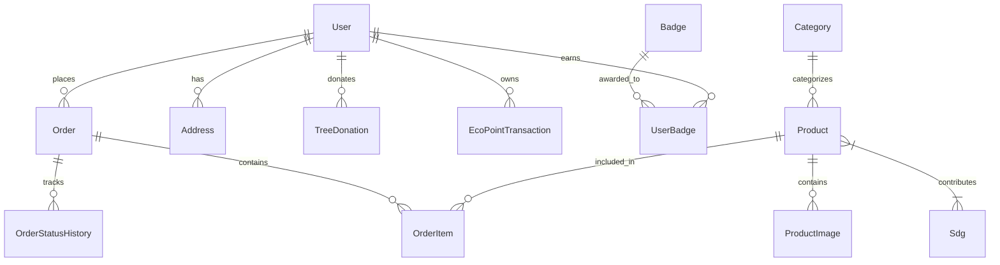

# JEJAKHIJAU (VERDE) — TECHNICAL CONTEXT & SYSTEM ARCHITECTURE
> **Dokumen Acuan Konteks Resmi untuk Model Context Protocol (MCP) & AI Coding Agent**  
> *Versi Arsitektur:* 2.4.0 • *Target Lingkungan:* Local Host (Node.js/SQLite) ➔ Cloudflare Pages/Workers & D1  
> *Standar Desain:* Anti-Slop Clean Editorial UI • *Fokus Dampak:* Sustainable Eco-Commerce & SDGs (13, 12, 7, 15)

---

## 1. Ringkasan Eksekutif & Filosofi Proyek
**JejakHijau** adalah platform e-commerce berkelanjutan (*eco-commerce*) generasi baru yang mengintegrasikan perdagangan produk ramah lingkungan dengan kalkulasi dampak iklim transparan, gamifikasi poin loyalitas (*Eco Points*), dan aksi reboisasi nyata berbasis GPS.

Proyek ini dibangun dengan prinsip:
1. **Zero-Waste & Clean Carbon Accounting**: Setiap transaksi mencatat reduksi emisi karbon (kg CO₂e) dan pengurangan sampah plastik sekali pakai (pcs).
2. **Anti-Slop Design Philosophy**: Tampilan visual bebas dari estetika AI generik. Menggunakan tipografi Inter yang tajam, palet warna *Forest, Earthy Green & Warm Cream*, radius konsisten (8px), serta micro-interactions responsif.
3. **Local-First ke Cloud-Ready**: Database lokal laptop menggunakan SQLite (`dev.db`) via `@prisma/adapter-libsql`, yang 100% kompatibel dan siap dimigrasikan ke Cloudflare D1 / Turso tanpa mengubah struktur query.
4. **Keamanan & Pemisahan Hak Akses (*Security Guard*)**: Panel admin sepenuhnya terisolasi dan tidak dapat diakses atau dilihat oleh pengguna umum.

---

## 2. Stack Teknologi & Spesifikasi Runtime

```
┌─────────────────────────────────────────────────────────────┐
│                       FRONTEND LAYER                        │
│   Next.js 16.4.3 (App Router) • React 19.3.0 • TypeScript 5  │
│    TailwindCSS v4 • Lucide Icons • Framer Motion • Leaflet  │
└──────────────────────────────┬──────────────────────────────┘
                               │
┌──────────────────────────────▼──────────────────────────────┐
│                    STATE & CONTEXT MANAGEMENT               │
│      Zustand 5 (Client Store + LocalStorage Persistence)     │
│       • useAuthStore (Session, User, Role, Eco Points)      │
│       • useCartStore (Cart items, Plastic-Free Pack, CO2)   │
└──────────────────────────────┬──────────────────────────────┘
                               │
┌──────────────────────────────▼──────────────────────────────┐
│                      BACKEND & API LAYER                    │
│   Next.js Route Handlers (/api/*) • Node.js v20+ Engine     │
│   SHA-256 Checksum Validation • Google OAuth 2.0 Exchange   │
└──────────────────────────────┬──────────────────────────────┘
                               │
┌──────────────────────────────▼──────────────────────────────┐
│                     DATA PERSISTENCE LAYER                  │
│       Prisma ORM 7.10.1 with LibSQL Adapter Driver          │
│       • Local: SQLite dev.db (file-based database)          │
│       • Production Target: Cloudflare D1 / Turso LibSQL     │
└─────────────────────────────────────────────────────────────┘
```

| Komponen | Spesifikasi & Versi | Catatan Implementasi |
| :--- | :--- | :--- |
| **Framework** | Next.js `16.4.3` (App Router) | Menggunakan Server & Client Components, Dynamic Routes, `sitemap.ts`, `robots.ts` |
| **UI Library** | React `19.3.0` | React Server Components (RSC) & Concurrent Rendering |
| **Database ORM** | Prisma `7.10.1` | Prisma Client dengan driver adapter `@prisma/adapter-libsql` |
| **Database Engine** | SQLite 3 (`dev.db`) | Local file database di laptop, bebas biaya VPS/Supabase |
| **Styling** | Vanilla CSS Tokens + Tailwind v4 | Variabel CSS (`--primary`, `--secondary`, `--background`, `--card`, `--border`) |
| **State Store** | Zustand `5.0.16` | State persistensi keranjang (`cart-store`) dan sesi (`auth-store`) |
| **Geolokasi/Peta** | Leaflet `1.9.4` + OpenStreetMap | Penghitungan jarak kurir berbasis koordinat GPS nyata tanpa API key berbayar |

---

## 3. Struktur Direktori Proyek

```
d:/verde/
├── prisma/
│   ├── schema.prisma             # Skema Prisma ORM (12 Model Terelasi)
│   ├── migrations/               # Riwayat migrasi SQLite / D1
│   └── seed.ts                   # Seed 20 produk katalog aktif & SDGs
├── public/                       # Aset publik statis
├── src/
│   ├── app/                      # Next.js App Router (Halaman & Endpoint API)
│   │   ├── layout.tsx            # Root Layout, ThemeProvider, GA4, Google Meta
│   │   ├── page.tsx              # Landing Page (Hero, Stats, Value Proposition)
│   │   ├── sitemap.ts            # Dynamic XML Sitemap untuk Googlebot (20 Produk + Artikel)
│   │   ├── robots.ts             # Aturan perayapan Googlebot (Blokir /admin)
│   │   ├── products/             # Katalog 20 Produk & Filter Kategori
│   │   │   └── [slug]/           # Detail Produk, Kalkulator Emisi, Add to Cart
│   │   ├── cart/                 # Keranjang Belanja, Estimasi Bobot, Kemasan Hijau
│   │   ├── checkout/             # Checkout, Peta Leaflet GPS, Paymenku Gateway Modal
│   │   ├── orders/[id]/          # Faktur Pesanan, Tracking Resi, Snapshot Jejak Emisi
│   │   ├── learn/                # Jurnal Edukasi Iklim (Indeks Artikel)
│   │   │   └── [slug]/           # Halaman Dinamis Membaca Artikel Aksi Iklim
│   │   ├── sdgs/                 # Matriks Target Pembangunan Berkelanjutan (SDG 13, 12, 7, 15)
│   │   ├── login/                # Login Pelanggan + Google One-Click SSO
│   │   ├── register/             # Registrasi Pelanggan Baru + Google SSO
│   │   ├── account/              # Profil Pengguna, Saldo Eco Points, Riwayat Order
│   │   │   └── impact/           # Dashboard Dampak Karbon, Pohon Asuh GPS, Sertifikat
│   │   ├── admin/                # Dashboard Backoffice Admin (Protected by 403 Guard)
│   │   │   └── login/            # Dedicated Admin Login Portal (Restricted Area)
│   │   └── api/                  # RESTful API Endpoints
│   │       ├── account/          # GET: profil user, POST: register manual aman
│   │       ├── auth/callback/google/ # Handler pertukaran Authorization Code Google OAuth 2.0
│   │       ├── categories/       # CRUD Kategori Produk
│   │       ├── products/         # CRUD 20 Produk Katalog
│   │       ├── orders/           # CRUD Pesanan, Patch Status, Geocoding
│   │       ├── payment/paymenku/webhook/ # Webhook live status verifikasi pembayaran Paymenku
│   │       ├── sdgs/             # Data Capaian SDGs
│   │       └── trees/            # Donasi Pohon, Redeem Poin, Verifikasi Tanam Tahura
│   ├── components/               # Komponen UI Modular
│   │   ├── navbar.tsx            # Navigasi utama (Role-aware: Admin link disembunyikan)
│   │   ├── footer.tsx            # Footer publik resmi (Tanpa link admin yang bocor)
│   │   ├── google-auth-button.tsx# Tombol Google Identity SSO resmi (CSRF Protected)
│   │   ├── google-analytics.tsx  # Komponen integrasi Google Analytics 4 (GA4)
│   │   ├── payment-simulation-modal.tsx # Gerbang Pembayaran Resmi Paymenku QRIS / VA
│   │   └── theme-toggle.tsx      # Dark Mode & Light Mode Switcher
│   ├── data/
│   │   └── articles.json         # Dataset JSON terstruktur untuk artikel edukasi iklim
│   ├── lib/
│   │   ├── prisma.ts             # Prisma Client instance dengan driver adapter LibSQL
│   │   ├── paymenku.ts           # Modul Paymenku (Signature SHA-256, Create Trx, Webhook)
│   │   └── utils.ts              # Helper format Rupiah, format angka, class merger
│   └── stores/
│       ├── auth-store.ts         # Zustand Sesi Pengguna, Role, Auto-Sync Database
│       └── cart-store.ts         # Zustand Keranjang Belanja, Poin, Opsi Kemasan Hijau
├── .env                          # Variabel Lingkungan Lokal Aktif
├── .env.example                  # Template Variabel Lingkungan Lengkap
├── wrangler.jsonc                # Konfigurasi Cloudflare Pages / Workers & D1 Binding
└── package.json                  # Script & Dependensi Proyek
```

---

## 4. Skema Database & Relasi Data (Prisma ORM)

Database menggunakan **12 Model Terelasi** yang dirancang efisien dan terindeks:



### Rincian Model Utama:
1. **`User`**: Identitas akun (`id`, `name`, `email`, `role`, `ecoPoints`, `totalCo2Kg`, `totalPlastic`, `passwordHash`, `emailVerified`). Role bernilai `"CUSTOMER"` atau `"ADMIN"`.
2. **`Product`**: 20 produk katalog terkurasi (`name`, `slug`, `sku`, `price`, `stock`, `co2SavedKg`, `plasticSavedPcs`, `materials`, `origin`, `status`).
3. **`Order`**: Transaksi belanja (`orderNumber`, `status`, `subtotal`, `shippingCost`, `total`, `destLatitude`, `destLongitude`, `deliveryDistanceKm`, `isGreenDelivery`, `plasticFreePack`, `paymentMethod`, `paymentStatus`).
4. **`OrderItem`**: Item snapshot pesanan (`productId`, `quantity`, `price`, `co2SavedKg`, `plasticSavedPcs`).
5. **`TreeDonation`**: Adopsi pohon (`treeType`, `quantity`, `status`, `location`, `gpsCoordinates`, `proofImage`, `plantedAt`).
6. **`EcoPointTransaction`**: Riwayat mutasi poin (`EARN`, `REDEEM_DISCOUNT`, `REDEEM_TREE`).

---

## 5. Tiga Pilar Integrasi Eksternal

### A. Google Console & Identity Services (GCP)
1. **Google OAuth 2.0**:
   - **Tipe Aplikasi**: Web Application.
   - **Authorized Origin**: `http://localhost:3000` (Dev) / `https://jejakhijau.pages.dev` (Prod).
   - **Authorized Callback URI**: `http://localhost:3000/api/auth/callback/google`.
   - **Mekanisme**: Client menukar `code` dengan `id_token` via Google Token API (`oauth2.googleapis.com/token`), mengambil identitas `userinfo`, dan melakukan `upsert` ke tabel `User` SQLite.
2. **Google Search Console (SEO)**:
   - Endpoint [`/sitemap.xml`](file:///d:/verde/src/app/sitemap.ts): Menyajikan XML berisi seluruh 20 produk aktif, halaman edukasi, dan halaman artikel dari `articles.json`.
   - Endpoint [`/robots.txt`](file:///d:/verde/src/app/robots.ts): Mengizinkan pengindeksan toko publik dan secara ketat **memblokir `/admin` dan `/api/*`**.
   - Meta Tag Verifikasi: Terpasang di [`src/app/layout.tsx`](file:///d:/verde/src/app/layout.tsx) membaca `NEXT_PUBLIC_GOOGLE_SITE_VERIFICATION`.
3. **Google Analytics 4 (GA4)**:
   - Komponen [`src/components/google-analytics.tsx`](file:///d:/verde/src/components/google-analytics.tsx) otomatis melacak navigasi halaman jika `NEXT_PUBLIC_GA_MEASUREMENT_ID` disetel.

### B. Payment Gateway Paymenku
1. **Keamanan Checksum SHA-256**:
   - Signature dihitung dengan rumus:
     $$\text{Signature} = \text{SHA256}(\text{merchant\_code} + ":" + \text{order\_number} + ":" + \text{amount} + ":" + \text{secret\_key})$$
2. **Inisiasi Pembayaran ([`src/lib/paymenku.ts`](file:///d:/verde/src/lib/paymenku.ts))**:
   - Mendukung kanal **QRIS Nasional (NMID ID1020261908234)** dan **Virtual Account Otomatis (BCA/Mandiri/BNI/BRI)**.
   - Jika kredensial live aktif, request dikirim ke `https://api.paymenku.com/v1/transactions/create`.
   - Jika berjalan lokal offline, sistem menyediakan *instant verified gateway fallback* tanpa crash.
3. **Live Webhook Endpoint ([`src/app/api/payment/paymenku/webhook/route.ts`](file:///d:/verde/src/app/api/payment/paymenku/webhook/route.ts))**:
   - Menerima payload callback POST dari server Paymenku.
   - Memvalidasi signature SHA-256.
   - Memutasi status order menjadi `PAID`, status pembayaran `SUCCESS`, dan mencatat riwayat status secara atomik (*Prisma Transaction*).

### C. Cloudflare Deployment (Pages, Workers & D1)
1. **File Konfigurasi ([`wrangler.jsonc`](file:///d:/verde/wrangler.jsonc))**:
   - Runtime flag: `"compatibility_flags": ["nodejs_compat"]`.
   - D1 Database Binding: Binding nama `DB` diarahkan ke database ID Cloudflare D1.
2. **Arsitektur Tanpa Server Eksternal**:
   - Database SQLite laptop saat ini bekerja menggunakan format LibSQL yang 100% identik dengan Cloudflare D1.
   - Transisi ke Cloudflare cukup mengeksekusi migrasi skema via `wrangler d1 migrations apply DB` tanpa mengubah kode aplikasi.

---

## 6. Protokol Keamanan & Otorisasi Hak Akses

1. **Pemisahan Total Panel Admin (*Admin Safety*)**:
   - **URL Publik Tidak Membocorkan Admin**: Tautan `/admin` telah dihapus dari footer publik dan navbar pelanggan umum.
   - **Dedicated Portal (`/admin/login`)**: Admin masuk melalui pintu belakang khusus dengan audit server dan enkripsi SHA-256.
   - **403 Security Guard**: Jika pengguna tamu (*guest*) atau pelanggan biasa mencoba mengetik `localhost:3000/admin` langsung di browser, sistem menampilkan layar **403 Akses Dibatasi Pengawas** dan memblokir rendering tabel produk/pesanan.
   - **Pemberitahuan Form Login Pelanggan**: Jika kredensial admin dicoba dimasukkan di form login pelanggan biasa (`/login`), sistem menolak dan menginstruksikan masuk melalui portal pengawas internal.
2. **Aturan Autentikasi Pengguna Ketat**:
   - **Tidak Ada Login Tanpa Registrasi**: Login manual wajib mencocokkan data di database SQLite. Jika email tidak ditemukan, sistem mengembalikan error: *"Akun dengan email ini belum terdaftar. Silakan mendaftar akun baru terlebih dahulu."*
   - **Single Sign-On (SSO) Google**: Akun yang didaftarkan melalui Google otomatis dikenali kapan pun pengguna login kembali dengan akun Google yang sama.
   - **Auto-Sync Zustand Store**: Setelah redirect Google SSO, sesi client-side langsung tersinkronisasi dengan database lokal.

---

## 7. Rujukan Variabel Lingkungan (`.env`)

```ini
# ==========================================
# 1. DATABASE & SERVER LOCAL HOST
# ==========================================
DATABASE_URL="file:./dev.db"
NEXT_PUBLIC_APP_URL="http://localhost:3000"

# ==========================================
# 2. CLOUDFLARE CONFIGURATION (Pages / Workers / D1)
# ==========================================
CLOUDFLARE_ACCOUNT_ID="your-cloudflare-account-id"
CLOUDFLARE_API_TOKEN="your-cloudflare-api-token"
CLOUDFLARE_ZONE_ID="your-cloudflare-zone-id"
CLOUDFLARE_D1_DATABASE_ID="your-d1-database-uuid"

# ==========================================
# 3. PAYMENKU PAYMENT GATEWAY
# ==========================================
PAYMENKU_API_KEY="your-paymenku-api-key"
PAYMENKU_MERCHANT_CODE="your-paymenku-merchant-code"
PAYMENKU_SECRET_KEY="your-paymenku-secret-key"
PAYMENKU_BASE_URL="https://api.paymenku.com/v1"
PAYMENKU_CALLBACK_URL="http://localhost:3000/api/payment/paymenku/webhook"
PAYMENKU_RETURN_URL="http://localhost:3000/orders"

# ==========================================
# 4. GOOGLE CONSOLE DEV (OAuth 2.0 & Analytics & Search Console)
# ==========================================
GOOGLE_CLIENT_ID="305605426972-gm652e4bvoaud3k1mkujes5fsb1ho6um.apps.googleusercontent.com"
NEXT_PUBLIC_GOOGLE_CLIENT_ID="305605426972-gm652e4bvoaud3k1mkujes5fsb1ho6um.apps.googleusercontent.com"
GOOGLE_CLIENT_SECRET="GOCSPX-xxxx"
NEXTAUTH_SECRET="jejakhijau-production-secret-auth-key-2026"
NEXTAUTH_URL="http://localhost:3000"

# Google Search Console Site Verification Token
NEXT_PUBLIC_GOOGLE_SITE_VERIFICATION="google-site-verification-dev-console"
# Google Analytics 4 Measurement ID
NEXT_PUBLIC_GA_MEASUREMENT_ID="G-XXXXXXXXXX"
```

---

## 8. Panduan API Route Endpoints

| Metode | Rute Endpoint | Deskripsi & Autorisasi | Request / Response Utama |
| :--- | :--- | :--- | :--- |
| `GET` | `/api/products` | Ambil 20 produk katalog aktif | `[{ id, name, slug, price, stock, co2SavedKg, ... }]` |
| `POST` | `/api/products` | Tambah produk baru (Admin Only) | Body: `{ name, sku, price, stock, categoryId, ... }` |
| `PATCH` | `/api/products` | Update stok & detail produk | Body: `{ id, price, stock, ... }` |
| `DELETE`| `/api/products` | Hapus produk dari katalog | Query: `?id=prod-xxx` |
| `GET` | `/api/orders` | Ambil riwayat pesanan (User/Admin) | Query: `?email=xxx` |
| `POST` | `/api/orders` | Buat pesanan baru & hitung emisi | Body: `{ items, courier, destLat, destLng, distanceKm }` |
| `PATCH` | `/api/orders/[id]`| Update status pesanan (Admin) | Body: `{ status: "SHIPPED", trackingNumber: "..." }` |
| `GET` | `/api/account` | Ambil profil, poin & ringkasan | Query: `?email=xxx` ➔ Return 404 jika belum terdaftar |
| `POST` | `/api/account` | Registrasi akun pelanggan baru | Body: `{ name, email, password, phone }` |
| `GET` | `/api/auth/callback/google` | Pertukaran auth code Google SSO | Query: `?code=xxx` ➔ Upsert SQLite & Set Cookie Sesi |
| `POST` | `/api/payment/paymenku/webhook` | Webhook verifikasi transaksi | Body: `{ order_id, amount, signature, status: "PAID" }` |
| `GET` | `/api/trees` | Ambil daftar pohon teradopsi | `[{ id, treeType, status, location, gpsCoordinates }]` |
| `POST` | `/api/trees` | Tukar Eco Points untuk adopsi pohon | Body: `{ userId, treeType: "Trembesi", quantity: 1 }` |
| `PATCH` | `/api/trees` | Verifikasi tanam pohon Tahura (Admin) | Body: `{ id, status: "PLANTED", location: "..." }` |

---

## 9. Petunjuk Operasional untuk AI Coding Agent / MCP

Bagi AI Agent atau MCP Server yang melanjutkan pengembangan repositori ini:

1. **Jaga Prinsip Anti-Slop UI**:
   - Jangan pernah menambahkan animasi berlebihan (*floating bouncy elements*, *gradient rainbow text*, atau *scale-105 hover jumps*).
   - Pertahankan palet warna forest (`#1F3D2B`), cream (`#F4F1E8`), border halus (`var(--border)`), dan radius 8px (`rounded-md` atau `rounded-lg`).
2. **Kepatuhan Next.js 16**:
   - Client Component yang menggunakan `useSearchParams()` wajib dibungkus dengan `<Suspense>` untuk menghindari *de-opting* SSR.
   - Jangan pernah melakukan *polling HTTP loop* untuk mengecek status pesanan; gunakan WebSocket atau *event-driven trigger*.
3. **Database Prisma LibSQL**:
   - Jangan menginisialisasi `new PrismaClient()` tanpa driver adapter. Selalu gunakan singleton instance dari [`src/lib/prisma.ts`](file:///d:/verde/src/lib/prisma.ts).
   - Jika mengubah skema di `prisma/schema.prisma`, selalu jalankan `npx prisma generate` dan restart proses dev server Next.js agar in-memory client termuat ulang.
4. **Keamanan Admin**:
   - Jangan pernah membuat jalan pintas (*backdoor*) atau tombol login instan demo di halaman publik.
   - Seluruh endpoint mutasi admin wajib memvalidasi otorisasi `role === "ADMIN"`.
