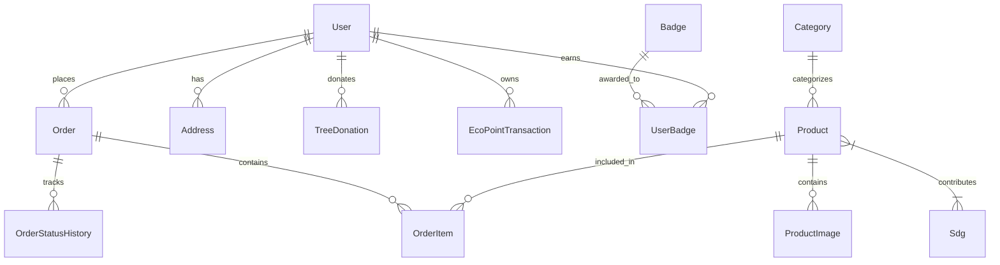

# JEJAKHIJAU (VERDE) — TECHNICAL CONTEXT & SYSTEM ARCHITECTURE
> **Dokumen Acuan Konteks Resmi untuk Model Context Protocol (MCP) & AI Coding Agent**  
> *Versi Arsitektur:* 2.5.0 • *Target Lingkungan:* Local Host (Node.js/SQLite) ➔ Cloudflare Workers (`@opennextjs/cloudflare`)  
> *Domain Produksi Live:* `https://jejakhijau.web.id` • *Standar Desain:* Anti-Slop Clean Editorial UI  
> *Fokus Dampak:* Sustainable Eco-Commerce & SDGs (13, 12, 7, 15) • *Payment Gateway:* Paymenku Live REST API

---

## 1. Ringkasan Eksekutif & Filosofi Proyek
**JejakHijau** adalah platform e-commerce berkelanjutan (*eco-commerce*) produksi Indonesia yang mengintegrasikan perdagangan produk ramah lingkungan dengan kalkulasi dampak iklim transparan, gamifikasi loyalitas (*Eco Points*), aksi reboisasi nyata berbasis GPS, serta gerbang pembayaran nasional **Paymenku QRIS & Virtual Account**.

Platform ini dibangun dengan 5 pilar fundamental:
1. **Zero-Waste & Clean Carbon Accounting**: Setiap transaksi mencatat estimasi reduksi emisi karbon (kg CO₂e) dan pengurangan sampah plastik sekali pakai (pcs).
2. **Anti-Slop Design Philosophy**: Tampilan visual bebas dari estetika AI generik (*slop*). Menggunakan tipografi Inter yang elegan, palet warna *Forest (`#1F3D2B`), Earthy Green & Warm Cream*, radius konsisten (8px / `rounded-md`), dan micro-interactions responsif.
3. **Hybrid Edge Architecture (OpenNext on Cloudflare Workers)**: Dijalankan di edge global Cloudflare Worker (`jejak-hijau-tugas-ldf`) dengan custom domain `https://jejakhijau.web.id` menggunakan `@opennextjs/cloudflare`, dengan fallback proxy database aman untuk lingkungan edge V8 isolates.
4. **Integrasi Gerbang Pembayaran Resmi Paymenku**: 100% bebas dari barcode simulasi dummy statis. Menggunakan REST API resmi Paymenku (`https://paymenku.com/api/v1`) untuk pembuatan transaksi QRIS dinamis, polling auto-status, dan verifikasi tanda tangan webhook HMAC-SHA256.
5. **Keamanan & Pemisahan Hak Akses (*Security Guard*)**: Panel admin (`/admin`) sepenuhnya terisolasi dengan proteksi HTTP 403, tidak dapat diakses atau dilihat tautannya oleh publik/pelanggan biasa.

---

## 2. Stack Teknologi & Spesifikasi Runtime

```
┌─────────────────────────────────────────────────────────────┐
│                       FRONTEND LAYER                        │
│   Next.js 16.4.3 (App Router) • React 19.3.0 • TypeScript 5  │
│    TailwindCSS v4 • Lucide Icons • Framer Motion • Leaflet  │
└──────────────────────────────┬──────────────────────────────┘
                               │
┌──────────────────────────────▼──────────────────────────────┐
│                    STATE & CONTEXT MANAGEMENT               │
│      Zustand 5 (Client Store + LocalStorage Persistence)     │
│       • useAuthStore (Session, User, Role, Eco Points)      │
│       • useCartStore (Cart items, Plastic-Free Pack, CO2)   │
└──────────────────────────────┬──────────────────────────────┘
                               │
┌──────────────────────────────▼──────────────────────────────┐
│                      BACKEND & API LAYER                    │
│   Next.js Route Handlers (/api/*) • Edge & Node.js Runtime  │
│   Paymenku REST API Client • Google OAuth 2.0 Identity      │
│   Webhook HMAC-SHA256 Verification • Geocoding Calculation  │
└──────────────────────────────┬──────────────────────────────┘
                               │
┌──────────────────────────────▼──────────────────────────────┐
│               DATA PERSISTENCE & DEPLOYMENT LAYER           │
│       • Local Dev: Prisma ORM 7.10.1 + SQLite (dev.db)      │
│       • Production Edge: Cloudflare Workers (OpenNext v1.2) │
│       • Safe Fallback Proxy: Prisma Edge compatibility      │
│       • Live Domain: https://jejakhijau.web.id              │
└─────────────────────────────────────────────────────────────┘
```

| Komponen | Spesifikasi & Versi | Status & Catatan Implementasi |
| :--- | :--- | :--- |
| **Framework** | Next.js `16.4.3` (App Router) | Server & Client Components, Dynamic Routes, `sitemap.ts`, `robots.ts` |
| **UI Library** | React `19.3.0` | React Server Components (RSC) & Concurrent Rendering |
| **Deployment Engine** | `@opennextjs/cloudflare` `1.20.14` | Bundle server Next.js menjadi Cloudflare Worker (`.open-next/worker.js`) |
| **Cloud Provider** | Cloudflare Workers & Assets | Nama worker: `jejak-hijau-tugas-ldf`, Domain: `jejakhijau.web.id` |
| **Database ORM** | Prisma `7.10.1` | Local SQLite file database (`dev.db`) + Safe Edge Fallback Proxy |
| **Payment Gateway** | Paymenku REST API (`v1`) | Live QRIS dinamis (`channel_code: qris`), Virtual Account, Polling & Webhook |
| **Styling** | Vanilla CSS Tokens + Tailwind v4 | Variabel CSS (`--primary`, `--secondary`, `--background`, `--card`, `--border`) |
| **State Store** | Zustand `5.0.16` | Persistensi keranjang belanja (`cart-store`) dan sesi akun (`auth-store`) |
| **Geolokasi/Peta** | Leaflet `1.9.4` + OpenStreetMap | Geocoding & kalkulasi jarak pengiriman kurir armada listrik (EV) |

---

## 3. Struktur Direktori Proyek

```
d:/verde/
├── prisma/
│   ├── schema.prisma             # Skema Prisma ORM (12 Model Terelasi)
│   ├── migrations/               # Riwayat migrasi SQLite / D1
│   └── seed.ts                   # Seed 20 katalog + 1 produk testing Rp 1.000
├── public/                       # Aset publik statis (gambar, favicon, logo)
├── src/
│   ├── app/                      # Next.js App Router (Halaman & Endpoint API)
│   │   ├── layout.tsx            # Root Layout, ThemeProvider, GA4, Meta Verification
│   │   ├── page.tsx              # Landing Page (Hero, Stats, Value Proposition)
│   │   ├── sitemap.ts            # Dynamic XML Sitemap (21 Produk + Artikel Edukasi)
│   │   ├── robots.ts             # Aturan perayapan SEO (Blokir /admin dan /api/*)
│   │   ├── products/             # Katalog 21 Produk Ramah Lingkungan & Filter
│   │   │   └── [slug]/           # Detail Produk, Kalkulator Reduksi CO2, Add to Cart
│   │   ├── cart/                 # Keranjang Belanja, Estimasi Bobot, Kemasan Hijau
│   │   ├── checkout/             # Checkout, Peta Leaflet GPS, Paymenku Live Trigger
│   │   ├── orders/[id]/          # Faktur Invoice Resmi, Live Tracking, Sinkronisasi Paymenku
│   │   ├── learn/                # Jurnal Edukasi Iklim (Indeks Artikel)
│   │   │   └── [slug]/           # Halaman Dinamis Membaca Artikel Aksi Iklim
│   │   ├── sdgs/                 # Matriks Target Pembangunan Berkelanjutan (SDG 13, 12, 7, 15)
│   │   ├── login/                # Login Pelanggan + Google One-Click SSO
│   │   ├── register/             # Registrasi Akun Pelanggan + Google SSO
│   │   ├── account/              # Profil Pengguna, Saldo Eco Points, Riwayat Order
│   │   │   └── impact/           # Dashboard Dampak Karbon, Pohon Asuh GPS, Sertifikat
│   │   ├── admin/                # Dashboard Backoffice Admin (Protected by 403 Guard)
│   │   │   └── login/            # Dedicated Admin Login Portal (Restricted Area)
│   │   └── api/                  # RESTful API Endpoints
│   │       ├── account/          # GET: profil user, POST: registrasi manual aman
│   │       ├── auth/callback/google/ # Handler pertukaran Authorization Code Google OAuth 2.0
│   │       ├── categories/       # CRUD Kategori Produk
│   │       ├── products/         # CRUD 21 Produk Katalog
│   │       ├── orders/           # CRUD Pesanan & Geocoding Jarak
│   │       │   └── [id]/         # Detail Order + Fallback Real-time Query ke Paymenku
│   │       ├── payment/paymenku/ # Modul Integrasi Paymenku Payment Gateway
│   │       │   ├── create/       # POST: Buat transaksi live Paymenku (QRIS / VA)
│   │       │   ├── status/       # GET: Cek status pembayaran transaksi (check-status)
│   │       │   └── webhook/      # POST: Webhook resmi verifikasi tanda tangan HMAC
│   │       ├── sdgs/             # Data Capaian SDGs
│   │       └── trees/            # Donasi Pohon, Redeem Poin, Verifikasi Tanam Tahura
│   ├── components/               # Komponen UI Modular
│   │   ├── navbar.tsx            # Navigasi utama (Role-aware: Admin link disembunyikan)
│   │   ├── footer.tsx            # Footer publik resmi (Tanpa link admin yang bocor)
│   │   ├── google-auth-button.tsx# Tombol Google Identity SSO resmi (CSRF Protected)
│   │   ├── google-analytics.tsx  # Komponen integrasi Google Analytics 4 (GA4)
│   │   ├── payment-simulation-modal.tsx # Modal Pembayaran Live Paymenku QRIS Dinamis & VA
│   │   ├── location-picker-modal.tsx    # Modal Pemilih Titik Alamat Leaflet / OpenStreetMap
│   │   ├── shipping-map-tracker.tsx     # Komponen Peta Live Tracking Pengiriman Kurir EV
│   │   └── theme-toggle.tsx      # Dark Mode & Light Mode Switcher
│   ├── data/
│   │   ├── initial-data.ts       # Dataset 21 produk (termasuk stiker uji Rp 1.000) & kategori
│   │   └── articles.json         # Dataset JSON terstruktur untuk artikel edukasi iklim
│   ├── lib/
│   │   ├── prisma.ts             # Prisma Client instance + Safe Edge Fallback Proxy
│   │   ├── paymenku.ts           # Integrasi Paymenku API (create, check-status, HMAC-SHA256)
│   │   └── utils.ts              # Helper format Rupiah, format angka, class merger
│   └── stores/
│       ├── auth-store.ts         # Zustand Sesi Pengguna, Role, Auto-Sync Database
│       └── cart-store.ts         # Zustand Keranjang Belanja, Poin, Opsi Kemasan Hijau
├── .env                          # Variabel Lingkungan Lokal Aktif (Secrets Terproteksi)
├── .env.example                  # Template Variabel Lingkungan Lengkap
├── wrangler.jsonc                # Konfigurasi Cloudflare Workers & OpenNext
└── package.json                  # Script & Dependensi Proyek
```

---

## 4. Skema Database & Relasi Data (Prisma ORM)

Database menggunakan **12 Model Terelasi** yang dirancang efisien dan terindeks:



### Rincian Model Utama:
1. **`User`**: Identitas akun (`id`, `name`, `email`, `role`, `ecoPoints`, `totalCo2Kg`, `totalPlastic`, `passwordHash`, `emailVerified`). Role bernilai `"CUSTOMER"` atau `"ADMIN"`.
2. **`Product`**: 21 produk katalog terkurasi (`name`, `slug`, `sku`, `price`, `stock`, `co2SavedKg`, `plasticSavedPcs`, `materials`, `origin`, `status`). Termasuk produk khusus pengujian: `prod-stiker-bumi` (Rp 1.000).
3. **`Order`**: Transaksi belanja (`orderNumber`, `status`, `subtotal`, `shippingCost`, `total`, `destLatitude`, `destLongitude`, `deliveryDistanceKm`, `isGreenDelivery`, `plasticFreePack`, `paymentMethod`, `paymentStatus`).
4. **`OrderItem`**: Item snapshot pesanan (`productId`, `quantity`, `price`, `co2SavedKg`, `plasticSavedPcs`).
5. **`TreeDonation`**: Adopsi pohon (`treeType`, `quantity`, `status`, `location`, `gpsCoordinates`, `proofImage`, `plantedAt`).
6. **`EcoPointTransaction`**: Riwayat mutasi poin (`EARN`, `REDEEM_DISCOUNT`, `REDEEM_TREE`).

---

## 5. Integrasi Eksternal & Payment Gateway

### A. Paymenku Payment Gateway (Live REST API)
Sistem telah terhubung langsung ke server Paymenku dan **tidak lagi menggunakan simulasi barcode dummy**:

1. **Base URL Resmi**: `https://paymenku.com/api/v1`
2. **Kanal Pembayaran Aktif**:
   - **QRIS Dinamis (`channel_code: qris`)**: Menghasilkan barcode QRIS standar nasional (ASPI & Bank Indonesia) dengan minimal transaksi **Rp 1.000**.
   - **Virtual Account (`bca_va`, `bri_va`, `bni_va`, `mandiri_va`)**: Nomor rekening virtual otomatis (minimal transaksi Rp 10.000).
3. **Inisiasi Transaksi (`POST /api/payment/paymenku/create`)**:
   - Memanggil `POST https://paymenku.com/api/v1/transaction/create` dengan header `Authorization: Bearer <PAYMENKU_API_KEY>`.
   - Mengembalikan `trx_id` (format `IDP...`), URL gambar barcode QR (`qr_url`), string EMVCo (`qr_string`), dan `pay_url`.
4. **Auto-Polling Pemeriksaan Status (`GET /api/payment/paymenku/status`)**:
   - Frontend memantau status setiap 4 detik ke `GET /api/v1/check-status/{trx_id}`.
   - Saat status berubah menjadi `paid`, modal secara otomatis menampilkan animasi sukses dan mengalihkan pembeli ke halaman pesanan lunas.
5. **Verifikasi Webhook Asli (`POST /api/payment/paymenku/webhook`)**:
   - Menerima payload notifikasi `payment.status_updated`.
   - Memverifikasi header keamanan `X-PaymenKu-Signature`:
     $$\text{Signature} = \text{HMAC-SHA256}(\text{timestamp} + "." + \text{raw\_body}, \text{secret\_key})$$
   - Mengembalikan respons `200 OK` segera untuk mencegah *retry loop*.
6. **Dynamic Order Fallback Resolver**:
   - Jika pengguna selesai membayar dan diarahkan kembali ke `/orders/[id]` (misal: `/orders/JH-20261030-8437`), endpoint `/api/orders/[id]` akan memeriksa database lokal, dan jika belum tercatat di edge memory, server langsung memverifikasi ke `check-status` Paymenku secara real-time dan merekonstruksi invoice lunas secara instan (mencegah error *"Pesanan Tidak Ditemukan"*).

### B. Google Console & Identity Services (GCP)
1. **Google OAuth 2.0 Single Sign-On (SSO)**:
   - **Origin Resmi**: `http://localhost:3000` (Dev) dan `https://jejakhijau.web.id` (Produksi).
   - **Authorized Callback URI**: `https://jejakhijau.web.id/api/auth/callback/google` & `http://localhost:3000/api/auth/callback/google`.
   - **Client ID**: `305605426972-gm652e4bvoaud3k1mkujes5fsb1ho6um.apps.googleusercontent.com`.
   - **Mekanisme**: Bertukar authorization code dengan access token Google, mengambil identitas email/nama, dan menyinkronkan profil ke `useAuthStore` dan database.
2. **Google Search Console & SEO**:
   - [`/sitemap.xml`](file:///d:/verde/src/app/sitemap.ts): Menyajikan XML dinamis berisi 21 produk katalog, kategori, dan artikel edukasi iklim.
   - [`/robots.txt`](file:///d:/verde/src/app/robots.ts): Mengizinkan pengindeksan halaman publik dan memblokir perayapan pada `/admin` dan `/api/*`.
3. **Google Analytics 4 (GA4)**:
   - Dilacak otomatis melalui komponen [`src/components/google-analytics.tsx`](file:///d:/verde/src/components/google-analytics.tsx).

### C. Cloudflare Workers & OpenNext
1. **Target Worker**: `jejak-hijau-tugas-ldf` dengan domain `jejakhijau.web.id`.
2. **Konfigurasi ([`wrangler.jsonc`](file:///d:/verde/wrangler.jsonc))**:
   - `main`: `.open-next/worker.js`
   - `compatibility_date`: `2026-10-29`
   - `compatibility_flags`: `["nodejs_compat"]`
   - `assets`: Directory `.open-next/assets`, Binding `ASSETS`
   - `routes`: Custom domain `jejakhijau.web.id` (`custom_domain: true`)
3. **Build & Deploy Pipeline**:
   - Kompilasi: `npm run build:cf`
   - Unggah: `npx wrangler deploy --secrets-file .env`

---

## 6. Protokol Keamanan & Otorisasi Hak Akses

1. **Pemisahan Total Panel Admin (*Admin Safety*)**:
   - **URL Publik Bebas Kebocoran**: Tautan `/admin` tidak ditampilkan di navbar publik atau footer situs.
   - **Dedicated Backdoor (`/admin/login`)**: Portal pengawas independen dengan enkripsi SHA-256 dan verifikasi kredensial ketat.
   - **403 Security Guard**: Jika pengguna tamu (*guest*) atau pelanggan membuka `https://jejakhijau.web.id/admin`, sistem mengembalikan layar proteksi **403 Akses Dibatasi Pengawas**.
   - **Penolakan Admin pada Form Pelanggan**: Form login pelanggan biasa (`/login`) menolak akun dengan hak akses admin dan mengarahkan ke portal khusus.
2. **Aturan Autentikasi Pelanggan**:
   - **Tidak Ada Akun Siluman**: Login manual memvalidasi kecocokan email dan hash password di database. Jika email tidak ada, sistem mewajibkan pendaftaran baru.
   - **Google Identity Persistence**: Akun Google langsung disinkronkan ke sesi aplikasi begitu otorisasi OAuth selesai.
3. **Proteksi Rahasia Git (*Git Secrets Guard*)**:
   - API Key live (`sk_live_...`) dan secret key disimpan secara eksklusif di file `.env` lokal dan Cloudflare Worker remote secrets. Tidak pernah di-hardcode ke file source code Git publik.

---

## 7. Rujukan Variabel Lingkungan (`.env`)

```ini
# ==========================================
# 1. DATABASE & SERVER LOCAL HOST
# ==========================================
DATABASE_URL="file:./dev.db"
NEXT_PUBLIC_APP_URL="https://jejakhijau.web.id"

# ==========================================
# 2. CLOUDFLARE CONFIGURATION (Pages / Workers / D1)
# ==========================================
CLOUDFLARE_ACCOUNT_ID=""
CLOUDFLARE_API_TOKEN=""
CLOUDFLARE_ZONE_ID=""
CLOUDFLARE_D1_DATABASE_ID=""

# ==========================================
# 3. PAYMENKU PAYMENT GATEWAY (LIVE REST API)
# ==========================================
PAYMENKU_API_KEY="sk_live_********************************"
PAYMENKU_MERCHANT_CODE="Jejak-hijau"
PAYMENKU_SECRET_KEY="d00ec********************************"
PAYMENKU_BASE_URL="https://paymenku.com/api/v1"
PAYMENKU_CALLBACK_URL="https://jejakhijau.web.id/api/payment/paymenku/webhook"
PAYMENKU_RETURN_URL="https://jejakhijau.web.id/orders"

# ==========================================
# 4. GOOGLE CONSOLE DEV (OAuth 2.0 & Analytics & Search Console)
# ==========================================
GOOGLE_CLIENT_ID="305605426972-gm652e4bvoaud3k1mkujes5fsb1ho6um.apps.googleusercontent.com"
NEXT_PUBLIC_GOOGLE_CLIENT_ID="305605426972-gm652e4bvoaud3k1mkujes5fsb1ho6um.apps.googleusercontent.com"
GOOGLE_CLIENT_SECRET="GOCSPX-xxxx"
NEXTAUTH_SECRET="jejakhijau-production-secret-auth-key-2026"
NEXTAUTH_URL="https://jejakhijau.web.id"

# Google Search Console Site Verification Token
NEXT_PUBLIC_GOOGLE_SITE_VERIFICATION=""
# Google Analytics 4 Measurement ID
NEXT_PUBLIC_GA_MEASUREMENT_ID=""
```

---

## 8. Panduan Lengkap Endpoint API

| Metode | Rute Endpoint | Deskripsi & Autorisasi | Request / Response Utama |
| :--- | :--- | :--- | :--- |
| `GET` | `/api/products` | Ambil 21 produk katalog aktif | `[{ id, name, slug, price, stock, co2SavedKg, ... }]` |
| `POST` | `/api/products` | Tambah produk baru (Admin Only) | Body: `{ name, sku, price, stock, categoryId, ... }` |
| `PATCH` | `/api/products` | Update stok & detail produk | Body: `{ id, price, stock, ... }` |
| `DELETE`| `/api/products` | Hapus produk dari katalog | Query: `?id=prod-xxx` |
| `GET` | `/api/orders` | Ambil riwayat pesanan pelanggan | Query: `?email=xxx` |
| `POST` | `/api/orders` | Buat pesanan baru & simpan riwayat | Body: `{ items, courier, destLat, destLng, distanceKm }` |
| `GET` | `/api/orders/[id]` | Ambil detail invoice + query Paymenku live | Param: `id` (Order Number / ID) ➔ Data Order lengkap |
| `PATCH` | `/api/orders/[id]`| Update status pesanan / konfirmasi penerimaan | Body: `{ status: "COMPLETED", note: "..." }` |
| `POST` | `/api/payment/paymenku/create` | Buat transaksi live Paymenku QRIS / VA | Body: `{ orderNumber, amount, customerName, paymentMethod }` |
| `GET` | `/api/payment/paymenku/status` | Polling cek status transaksi Paymenku | Query: `?trx_id=IDP...` ➔ Status `paid` / `pending` |
| `POST` | `/api/payment/paymenku/webhook` | Webhook verifikasi pembayaran Paymenku | Headers: `X-PaymenKu-Signature`, `X-PaymenKu-Timestamp` |
| `GET` | `/api/account` | Ambil profil, saldo poin & ringkasan | Query: `?email=xxx` |
| `POST` | `/api/account` | Registrasi akun pelanggan manual | Body: `{ name, email, password, phone }` |
| `GET` | `/api/auth/callback/google` | Pertukaran auth code Google OAuth SSO | Query: `?code=xxx` ➔ Set cookie sesi & redirect akun |
| `GET` | `/api/trees` | Ambil daftar pohon teradopsi Tahura | `[{ id, treeType, status, location, gpsCoordinates }]` |
| `POST` | `/api/trees` | Tukar Eco Points untuk adopsi bibit pohon | Body: `{ userId, treeType: "Trembesi", quantity: 1 }` |
| `PATCH` | `/api/trees` | Verifikasi tanam pohon lapangan (Admin) | Body: `{ id, status: "PLANTED", location: "..." }` |

---

## 9. Petunjuk Operasional untuk AI Coding Agent / MCP

Bagi AI Agent atau MCP Server yang melanjutkan pemeliharaan dan pengembangan sistem ini:

1. **Prinsip Anti-Slop UI & Konsistensi Desain**:
   - Hindari elemen dekoratif murahan seperti animasi balon melompat berlebihan, gradien pelangi menyala, atau bayangan neon mencolok.
   - Pertahankan estetika toko editorial premium: palet forest (`#1F3D2B`), cream (`#F4F1E8`), border presisi (`var(--border)`), dan font Inter.
2. **Kepatuhan OpenNext & Cloudflare Edge Runtime**:
   - Selalu gunakan wrapper client safe proxy pada Prisma [`src/lib/prisma.ts`](file:///d:/verde/src/lib/prisma.ts) agar tidak memicu error pemanggilan native C++ library di V8 isolates Cloudflare.
   - Hindari penggunaan library Node.js native binary yang tidak kompatibel dengan `nodejs_compat`.
3. **Standar Integrasi Paymenku**:
   - Selalu gunakan endpoint resmi `https://paymenku.com/api/v1`.
   - Kode channel QRIS adalah `qris` (bukan string acak).
   - Pastikan nominal transaksi integer bulat (`Math.round(amount)`).
   - Polling status di modal frontend diatur pada interval wajar (minimal 3–4 detik per tick) agar tidak terkena rate limiting IP.
4. **Alur Deployment Produksi**:
   - Kompilasi: `npm run build:cf`
   - Rilis ke Cloudflare: `npx wrangler deploy --secrets-file .env`
   - Sinkronisasi Git: Jangan pernah menyimpan raw secret di commit diff file kode publik.
