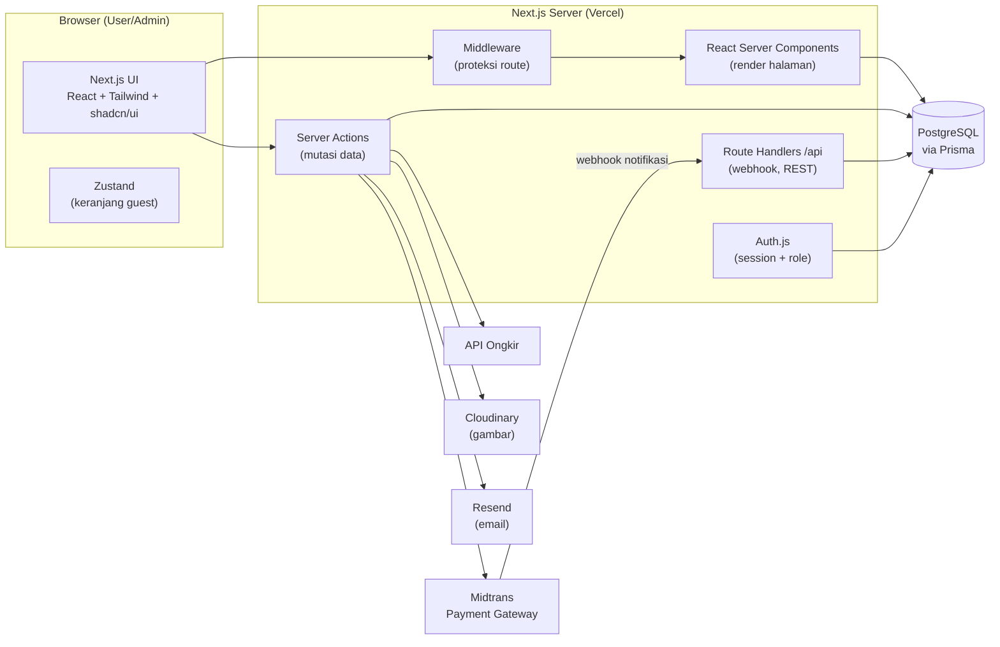
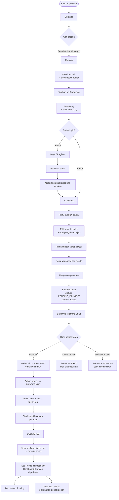
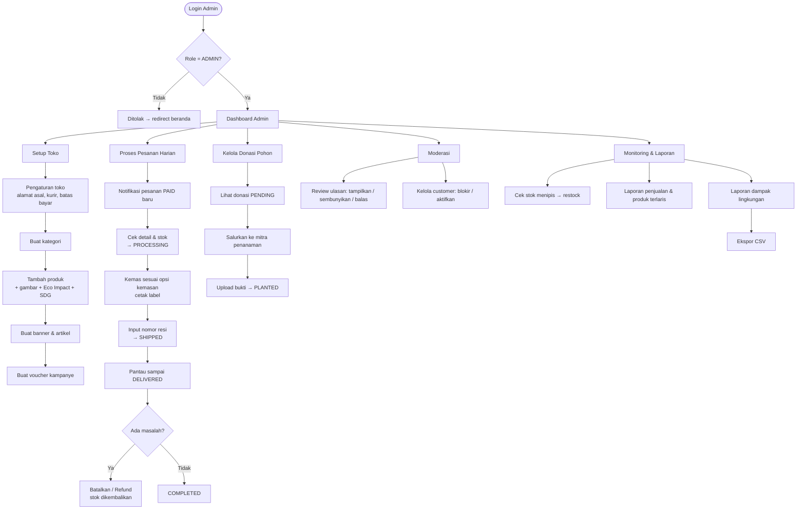
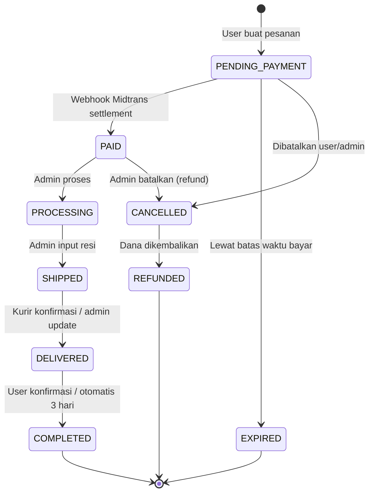
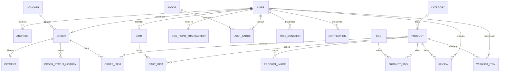

# 🌱 Blueprint E-Commerce **JejakHijau**
> *"Belanja yang Mengurangi Jejak Karbon"*

| Item | Keterangan |
|---|---|
| Jenis Aplikasi | Web E-Commerce (B2C, single vendor) |
| Isu Global | Global warming / perubahan iklim |
| SDGs | **13** Climate Action (utama), **12** Responsible Consumption & Production, **7** Affordable & Clean Energy, **15** Life on Land |
| Tech Stack | Full JavaScript/TypeScript modern (Next.js + PostgreSQL) |
| Role | Guest, Customer (User), Admin |
| Jumlah Produk Awal | 20 produk (5 kategori) |

---

## Daftar Isi
1. [Latar Belakang & Tujuan](#1-latar-belakang--tujuan)
2. [Pemetaan SDGs](#2-pemetaan-sdgs)
3. [Tech Stack](#3-tech-stack)
4. [Arsitektur Sistem](#4-arsitektur-sistem)
5. [Struktur Folder Project](#5-struktur-folder-project)
6. [Role & Hak Akses](#6-role--hak-akses)
7. [Daftar Fitur Lengkap](#7-daftar-fitur-lengkap)
8. [Alur User End-to-End](#8-alur-user-end-to-end)
9. [Alur Admin End-to-End](#9-alur-admin-end-to-end)
10. [Siklus Status Pesanan](#10-siklus-status-pesanan)
11. [Logika Bisnis Khusus (Eco Impact & Eco Points)](#11-logika-bisnis-khusus)
12. [Desain Database](#12-desain-database)
13. [Peta Halaman (Routing)](#13-peta-halaman-routing)
14. [API / Server Actions](#14-api--server-actions)
15. [Data Awal 20 Produk](#15-data-awal-20-produk)
16. [Desain UI/UX](#16-desain-uiux)
17. [Keamanan](#17-keamanan)
18. [Testing](#18-testing)
19. [Deployment & Environment](#19-deployment--environment)
20. [Roadmap Pengerjaan](#20-roadmap-pengerjaan)

---

## 1. Latar Belakang & Tujuan

### 1.1 Latar Belakang
Global warming dipicu oleh emisi gas rumah kaca dari pembangkit listrik berbahan fosil, sampah plastik sekali pakai, industri fast fashion, dan transportasi berbahan bakar minyak. Konsumen sebenarnya mau berubah, tetapi sering tidak tahu **produk apa** yang lebih ramah lingkungan dan **seberapa besar dampaknya**.

### 1.2 Masalah yang Diselesaikan
- Produk ramah lingkungan tersebar di banyak toko dan sulit dicari.
- Konsumen tidak bisa melihat dampak nyata (misalnya estimasi CO₂ yang dihemat) dari pembelian mereka.
- Tidak ada insentif untuk terus berbelanja secara berkelanjutan.

### 1.3 Tujuan
1. Menyediakan satu tempat belanja produk ramah lingkungan yang terkurasi.
2. Menampilkan **Eco Impact** (estimasi dampak lingkungan) di setiap produk dan pesanan.
3. Memberi insentif lewat **Eco Points** yang bisa ditukar diskon atau donasi bibit pohon.
4. Mengedukasi pengguna tentang perubahan iklim dan SDGs.

### 1.4 Target Pengguna
- Mahasiswa & pekerja muda (18–35 tahun) yang peduli lingkungan.
- Rumah tangga yang ingin mengurangi sampah plastik dan biaya listrik.
- Komunitas/organisasi lingkungan.

---

## 2. Pemetaan SDGs

| SDG | Target Terkait | Implementasi di JejakHijau |
|---|---|---|
| **13 – Climate Action** | 13.3 Edukasi & kesadaran mitigasi perubahan iklim | Label Eco Impact, kalkulator CO₂ di keranjang, dashboard dampak user, halaman edukasi |
| **12 – Responsible Consumption & Production** | 12.5 Mengurangi timbulan sampah; 12.8 Informasi gaya hidup berkelanjutan | Produk zero waste & daur ulang, opsi kemasan tanpa plastik, filter produk per SDG |
| **7 – Affordable & Clean Energy** | 7.2 Meningkatkan porsi energi terbarukan; 7.3 Efisiensi energi | Kategori produk energi surya & hemat listrik |
| **15 – Life on Land** | 15.2 Penghijauan & penanaman pohon | Produk adopsi bibit pohon, donasi pohon dari Eco Points |

---

## 3. Tech Stack

### 3.1 Ringkasan

| Layer | Teknologi | Alasan |
|---|---|---|
| Bahasa | **TypeScript** | Type-safe dari frontend sampai database |
| Framework Full-stack | **Next.js (App Router)** + React | SSR/SSG untuk SEO katalog, Server Actions untuk mutasi data, satu repo untuk FE & BE |
| Styling | **Tailwind CSS** | Cepat, konsisten, mudah dibuat tema "hijau" |
| Komponen UI | **shadcn/ui** (berbasis Radix UI) | Komponen aksesibel dan bisa dikustomisasi penuh |
| Ikon | **lucide-react** | Ringan dan konsisten |
| Animasi | **Framer Motion** | Micro-interaction (tambah ke keranjang, progress Eco Points) |
| Form & Validasi | **React Hook Form** + **Zod** | Validasi yang sama dipakai di client & server |
| State Client | **Zustand** (+ persist) | Keranjang guest disimpan di localStorage |
| Data Fetching Client | **TanStack Query** | Cache & refetch untuk bagian interaktif (cek ongkir, notifikasi) |
| ORM | **Prisma** | Skema database deklaratif, migrasi, type-safe query |
| Database | **PostgreSQL** (Neon / Supabase) | Relasional, cocok untuk transaksi & laporan |
| Autentikasi | **Auth.js (NextAuth)** | Login email+password & Google OAuth, session berbasis role |
| Pembayaran | **Midtrans Snap** (mode sandbox) | Payment gateway lokal: VA bank, QRIS, e-wallet |
| Ongkos Kirim | **API ongkir** (RajaOngkir/Komerce atau Biteship) | Hitung ongkir & daftar kurir |
| Upload Gambar | **Cloudinary** atau **UploadThing** | Simpan & optimasi gambar produk |
| Email | **Resend** + **React Email** | Email verifikasi, invoice, update status pesanan |
| Grafik Dashboard | **Recharts** | Grafik penjualan & dampak lingkungan |
| Tabel Admin | **TanStack Table** | Sorting, filter, pagination tabel data |
| Testing | **Vitest**, **React Testing Library**, **Playwright** | Unit, komponen, dan end-to-end |
| Kualitas Kode | **ESLint**, **Prettier**, **Husky** + lint-staged | Kode rapi sebelum commit |
| Deployment | **Vercel** (app) + Neon/Supabase (DB) | Deploy otomatis dari GitHub |
| Monitoring | Vercel Analytics, Sentry (opsional) | Pantau performa & error |

### 3.2 Catatan Pilihan
- **Kenapa tidak backend terpisah (Express/NestJS)?** Untuk skala tugas/MVP, Next.js Route Handlers + Server Actions sudah cukup dan lebih sederhana. Jika nanti butuh mobile app, Route Handlers di `/api` bisa dipakai sebagai REST API.
- **Midtrans** dipakai dalam **mode sandbox**, jadi tidak ada uang sungguhan selama pengembangan.

---

## 4. Arsitektur Sistem



**Prinsip arsitektur:**
- Halaman publik (beranda, katalog, detail produk, edukasi) dirender di server untuk SEO.
- Semua perubahan data (tambah keranjang, checkout, CRUD admin) lewat **Server Actions** yang divalidasi Zod dan dicek role-nya.
- Status pembayaran **hanya diubah oleh webhook Midtrans** yang terverifikasi signature-nya, bukan oleh client.

---

## 5. Struktur Folder Project

```
jejakhijau/
├── prisma/
│   ├── schema.prisma          # skema database
│   ├── migrations/
│   └── seed.ts                # seed 20 produk, kategori, admin awal
├── public/
│   └── images/
├── src/
│   ├── app/
│   │   ├── (shop)/            # halaman publik & customer
│   │   │   ├── page.tsx                 # beranda
│   │   │   ├── products/
│   │   │   │   ├── page.tsx             # katalog
│   │   │   │   └── [slug]/page.tsx      # detail produk
│   │   │   ├── cart/page.tsx
│   │   │   ├── checkout/page.tsx
│   │   │   ├── orders/
│   │   │   │   ├── page.tsx             # riwayat pesanan
│   │   │   │   └── [id]/page.tsx        # detail & tracking
│   │   │   ├── wishlist/page.tsx
│   │   │   ├── account/
│   │   │   │   ├── page.tsx             # profil
│   │   │   │   ├── addresses/page.tsx
│   │   │   │   ├── impact/page.tsx      # dashboard dampak & eco points
│   │   │   │   └── security/page.tsx
│   │   │   ├── learn/                   # edukasi & artikel
│   │   │   │   ├── page.tsx
│   │   │   │   └── [slug]/page.tsx
│   │   │   ├── sdgs/page.tsx
│   │   │   └── about/page.tsx
│   │   ├── (auth)/
│   │   │   ├── login/page.tsx
│   │   │   ├── register/page.tsx
│   │   │   ├── forgot-password/page.tsx
│   │   │   └── verify-email/page.tsx
│   │   ├── admin/
│   │   │   ├── layout.tsx               # sidebar admin + guard role
│   │   │   ├── page.tsx                 # dashboard
│   │   │   ├── products/...
│   │   │   ├── categories/...
│   │   │   ├── orders/...
│   │   │   ├── customers/...
│   │   │   ├── vouchers/...
│   │   │   ├── reviews/...
│   │   │   ├── articles/...
│   │   │   ├── banners/...
│   │   │   ├── tree-donations/...
│   │   │   ├── reports/...
│   │   │   └── settings/...
│   │   ├── api/
│   │   │   ├── auth/[...nextauth]/route.ts
│   │   │   ├── payment/webhook/route.ts # notifikasi Midtrans
│   │   │   ├── shipping/cost/route.ts
│   │   │   └── upload/route.ts
│   │   ├── layout.tsx
│   │   └── not-found.tsx
│   ├── components/
│   │   ├── ui/                # shadcn/ui
│   │   ├── shop/              # ProductCard, EcoImpactBadge, CartDrawer, ...
│   │   └── admin/             # DataTable, StatCard, Chart, ...
│   ├── actions/               # server actions per domain
│   │   ├── cart.ts
│   │   ├── checkout.ts
│   │   ├── product.ts
│   │   ├── order.ts
│   │   ├── review.ts
│   │   ├── voucher.ts
│   │   └── eco-points.ts
│   ├── lib/
│   │   ├── prisma.ts
│   │   ├── auth.ts
│   │   ├── midtrans.ts
│   │   ├── shipping.ts
│   │   ├── mailer.ts
│   │   ├── eco-impact.ts      # rumus perhitungan dampak
│   │   └── utils.ts           # formatRupiah, slugify, dll.
│   ├── schemas/               # skema Zod
│   ├── stores/                # Zustand (cart-store.ts)
│   ├── emails/                # template React Email
│   ├── types/
│   └── middleware.ts          # proteksi /admin, /account, /checkout
├── tests/
│   ├── unit/
│   └── e2e/
├── .env.example
├── package.json
└── README.md
```

---

## 6. Role & Hak Akses

| Fitur / Aksi | Guest | Customer | Admin |
|---|:---:|:---:|:---:|
| Lihat beranda, katalog, detail produk, artikel | ✅ | ✅ | ✅ |
| Cari, filter, urutkan produk | ✅ | ✅ | ✅ |
| Tambah ke keranjang | ✅ (localStorage) | ✅ (database) | ❌ |
| Wishlist | ❌ | ✅ | ❌ |
| Checkout & bayar | ❌ (diarahkan login) | ✅ | ❌ |
| Riwayat & tracking pesanan | ❌ | ✅ (milik sendiri) | ✅ (semua) |
| Ulasan produk | ❌ | ✅ (setelah pesanan selesai) | Moderasi |
| Eco Points & dashboard dampak | ❌ | ✅ | Lihat & atur aturan |
| CRUD produk, kategori, voucher, artikel, banner | ❌ | ❌ | ✅ |
| Kelola status pesanan & resi | ❌ | ❌ | ✅ |
| Kelola customer (blokir/aktifkan) | ❌ | ❌ | ✅ |
| Laporan penjualan & dampak | ❌ | ❌ | ✅ |
| Pengaturan toko | ❌ | ❌ | ✅ |

> Opsional untuk pengembangan lanjut: pisahkan role **SUPER_ADMIN** (kelola admin & pengaturan) dan **STAFF** (hanya proses pesanan).

---

## 7. Daftar Fitur Lengkap

### 7.1 Fitur Publik / Guest
| Kode | Fitur | Deskripsi |
|---|---|---|
| G-01 | Beranda | Hero banner kampanye iklim, statistik dampak komunitas (total CO₂ dihemat, pohon didonasikan), kategori, produk unggulan, produk terlaris, cuplikan artikel |
| G-02 | Katalog Produk | Grid produk dengan pagination atau infinite scroll |
| G-03 | Pencarian | Cari berdasarkan nama/deskripsi, dengan debounce |
| G-04 | Filter | Kategori, rentang harga, SDG terkait, rating, ketersediaan stok |
| G-05 | Urutkan | Terbaru, termurah, termahal, terlaris, dampak CO₂ terbesar |
| G-06 | Detail Produk | Galeri gambar, harga, stok, deskripsi, spesifikasi, **Eco Impact Badge**, SDG terkait, ulasan & rating, produk terkait |
| G-07 | Keranjang Guest | Disimpan di localStorage (Zustand), digabung ke akun setelah login |
| G-08 | Halaman Edukasi | Artikel tips mengurangi emisi & gaya hidup berkelanjutan |
| G-09 | Halaman SDGs | Penjelasan SDG 7, 12, 13, 15 dan kontribusi JejakHijau |
| G-10 | Tentang Kami & FAQ | Profil, misi, FAQ pengiriman/pembayaran |
| G-11 | Newsletter | Form langganan email |

### 7.2 Fitur Autentikasi
| Kode | Fitur | Deskripsi |
|---|---|---|
| A-01 | Registrasi | Nama, email, password (validasi kekuatan password) |
| A-02 | Verifikasi Email | Link verifikasi dikirim via email |
| A-03 | Login | Email+password atau **Login dengan Google** |
| A-04 | Lupa & Reset Password | Token reset berlaku terbatas (misal 30 menit) |
| A-05 | Logout | Hapus session |
| A-06 | Proteksi Route | Middleware mengarahkan user yang belum login / bukan admin |

### 7.3 Fitur Customer
| Kode | Fitur | Deskripsi |
|---|---|---|
| C-01 | Keranjang | Tambah, ubah jumlah, hapus item, cek stok real-time |
| C-02 | **Kalkulator Jejak Karbon** | Total estimasi CO₂ dihemat & plastik dikurangi dari isi keranjang |
| C-03 | Wishlist | Simpan produk favorit, pindahkan ke keranjang |
| C-04 | Buku Alamat | CRUD alamat, set alamat utama |
| C-05 | Checkout | Pilih alamat → kurir & ongkir → opsi kemasan → voucher → Eco Points → ringkasan |
| C-06 | **Pengiriman Hijau** | Opsi kurir kendaraan listrik (khusus area tertentu) & **kemasan tanpa plastik** |
| C-07 | Voucher | Masukkan kode voucher (persentase/nominal, min. belanja, kuota, masa berlaku) |
| C-08 | Pembayaran | Midtrans Snap: VA bank, QRIS, e-wallet; batas waktu bayar 24 jam |
| C-09 | Riwayat Pesanan | Daftar pesanan + filter status |
| C-10 | Detail & Tracking | Timeline status, nomor resi, invoice |
| C-11 | Invoice | Unduh/cetak invoice (halaman print-friendly atau PDF) |
| C-12 | Batalkan Pesanan | Hanya saat status `PENDING_PAYMENT` |
| C-13 | Konfirmasi Diterima | Ubah `DELIVERED` → `COMPLETED` (otomatis setelah X hari jika tidak dikonfirmasi) |
| C-14 | Ulasan & Rating | Rating 1–5 + komentar + foto, hanya untuk produk dari pesanan `COMPLETED` |
| C-15 | **Eco Points** | Dapat poin dari pesanan selesai, tukar diskon atau donasi bibit pohon |
| C-16 | **Dashboard Dampak Saya** | Total CO₂ dihemat, plastik dikurangi, pohon didonasikan, grafik per bulan, badge pencapaian |
| C-17 | **Eco Badge** | Contoh: "Pejuang Plastik" (10 produk zero waste), "Sahabat Surya" (beli produk energi surya), "Penanam Pohon" (donasi 5 pohon) |
| C-18 | Notifikasi | In-app + email: pembayaran berhasil, pesanan dikirim, pesanan selesai |
| C-19 | Profil & Keamanan | Ubah nama, foto, nomor HP, ganti password |

### 7.4 Fitur Admin
| Kode | Fitur | Deskripsi |
|---|---|---|
| AD-01 | Dashboard | Kartu statistik (pendapatan, pesanan, customer baru, produk stok menipis), grafik penjualan, **grafik total dampak lingkungan**, pesanan terbaru |
| AD-02 | Manajemen Produk | CRUD produk, multi-gambar, harga, stok, SKU, berat, **data Eco Impact**, SDG terkait, status aktif/draft |
| AD-03 | Manajemen Kategori | CRUD kategori + ikon |
| AD-04 | Manajemen Stok | Peringatan stok menipis, riwayat perubahan stok |
| AD-05 | Manajemen Pesanan | Tabel pesanan + filter status/tanggal, detail pesanan, ubah status, input nomor resi |
| AD-06 | Pembatalan & Refund | Batalkan pesanan, tandai refund (stok dikembalikan otomatis) |
| AD-07 | Manajemen Customer | Lihat daftar customer, detail pesanan per customer, blokir/aktifkan akun |
| AD-08 | Manajemen Voucher | CRUD voucher, kuota, masa berlaku, statistik pemakaian |
| AD-09 | Moderasi Ulasan | Sembunyikan/tampilkan ulasan, balas ulasan |
| AD-10 | Manajemen Artikel | CRUD artikel edukasi (editor rich text/markdown), status publish |
| AD-11 | Manajemen Banner | Banner kampanye di beranda (gambar, link, urutan, periode tayang) |
| AD-12 | **Donasi Pohon** | Daftar donasi bibit dari Eco Points & produk adopsi pohon, update status penanaman (`PENDING` → `PLANTED`), unggah foto bukti tanam |
| AD-13 | **Aturan Eco Points** | Atur rasio poin per rupiah, nilai tukar poin, biaya donasi pohon |
| AD-14 | Laporan | Laporan penjualan (harian/bulanan), produk terlaris, **laporan dampak lingkungan** (total CO₂, plastik, pohon) — ekspor CSV |
| AD-15 | Pengaturan Toko | Nama toko, alamat asal pengiriman, kurir aktif, batas waktu bayar, kontak |
| AD-16 | Log Aktivitas | Catatan siapa mengubah apa (audit log) |

---

## 8. Alur User End-to-End

### 8.1 Diagram Alur Utama



### 8.2 Langkah Detail

| # | Tahap | Aksi User | Respons Sistem |
|---|---|---|---|
| 1 | Discover | Membuka beranda | Tampil banner kampanye, statistik dampak komunitas, produk unggulan |
| 2 | Browse | Membuka katalog, memakai search/filter/sort | Daftar produk diperbarui; URL menyimpan query filter (`?category=energi&sort=impact`) |
| 3 | Evaluasi | Membuka detail produk | Tampil gambar, harga, stok, Eco Impact ("±0,5 kg CO₂ dihemat/tahun"), SDG terkait, ulasan |
| 4 | Add to Cart | Klik "Tambah ke Keranjang" | Validasi stok; toast sukses; badge keranjang bertambah |
| 5 | Review Cart | Membuka keranjang | Subtotal + **total estimasi dampak** dihitung; item stok habis ditandai |
| 6 | Auth | Klik checkout saat belum login | Diarahkan ke login dengan `callbackUrl=/checkout`; setelah login, keranjang guest digabung |
| 7 | Alamat | Pilih/menambah alamat | Alamat tersimpan; alamat utama terpilih otomatis |
| 8 | Pengiriman | Pilih kurir | Ongkir dihitung dari berat total & kota tujuan; opsi kurir listrik muncul jika area didukung |
| 9 | Kemasan | Centang "Kemasan tanpa plastik" | Ditambahkan ke catatan pesanan & poin bonus kecil |
| 10 | Diskon | Masukkan voucher / pakai Eco Points | Validasi voucher (aktif, kuota, min. belanja); potongan dihitung ulang |
| 11 | Buat Pesanan | Klik "Bayar Sekarang" | Transaksi DB: buat `Order` + `OrderItem`, kurangi stok, catat voucher; buat Snap token Midtrans |
| 12 | Bayar | Menyelesaikan pembayaran di popup Snap | Midtrans mengirim webhook → server verifikasi signature → status `PAID` → email invoice |
| 13 | Tunggu | Membuka detail pesanan | Timeline status: Dibayar → Diproses → Dikirim (+ resi) → Diterima |
| 14 | Terima | Klik "Pesanan Diterima" | Status `COMPLETED`; Eco Points & dampak ditambahkan ke akun; badge dicek |
| 15 | Ulas | Menulis ulasan | Ulasan tampil di produk; rating rata-rata diperbarui |
| 16 | Loyalitas | Membuka "Dampak Saya", menukar poin | Poin dikurangi; voucher pribadi dibuat **atau** donasi pohon tercatat (status `PENDING`) |
| 17 | Lacak Donasi | Melihat status donasi pohon | Saat admin menandai `PLANTED`, user mendapat notifikasi + foto bukti |

### 8.3 Alur Alternatif & Error
| Kondisi | Penanganan |
|---|---|
| Stok habis saat checkout | Pesanan ditolak, user diminta mengubah keranjang |
| Voucher tidak valid / kedaluwarsa | Pesan error di field voucher, total tidak berubah |
| Pembayaran gagal / ditutup | Pesanan tetap `PENDING_PAYMENT`, tombol "Bayar Lagi" tersedia sampai batas waktu |
| Tidak bayar dalam 24 jam | Cron job menandai `EXPIRED` dan mengembalikan stok & voucher |
| User diblokir admin | Tidak bisa login; tampil pesan menghubungi CS |
| Lupa password | Alur reset via email |

---

## 9. Alur Admin End-to-End

### 9.1 Diagram Alur Utama



### 9.2 Langkah Detail

| # | Tahap | Aksi Admin | Respons Sistem |
|---|---|---|---|
| 1 | Login | Login dengan akun role `ADMIN` | Middleware mengizinkan akses `/admin/*` |
| 2 | Setup | Mengisi pengaturan toko | Data tersimpan di tabel `Setting` |
| 3 | Kategori | Membuat 5 kategori | Slug dibuat otomatis |
| 4 | Produk | Mengisi form produk (nama, harga, stok, berat, gambar, Eco Impact, SDG) | Validasi Zod; gambar diunggah ke Cloudinary; produk berstatus `DRAFT` atau `ACTIVE` |
| 5 | Konten | Membuat banner, artikel, voucher | Tampil di beranda/halaman edukasi sesuai periode |
| 6 | Pantau | Membuka dashboard | Statistik & grafik dari agregasi query |
| 7 | Proses | Mengubah pesanan `PAID` → `PROCESSING` | Email "Pesanan diproses" ke customer; tercatat di `OrderStatusHistory` |
| 8 | Kirim | Input nomor resi → `SHIPPED` | Email berisi resi; timeline user diperbarui |
| 9 | Selesai | Pesanan `DELIVERED` → dikonfirmasi user / otomatis `COMPLETED` | Eco Points dikreditkan ke user |
| 10 | Masalah | Batalkan / refund | Stok & voucher dikembalikan; poin yang sudah dipakai dikembalikan |
| 11 | Donasi | Update status donasi pohon | Notifikasi ke user + foto bukti tanam |
| 12 | Moderasi | Menyembunyikan ulasan tidak pantas | Rating rata-rata dihitung ulang |
| 13 | Laporan | Memilih rentang tanggal → ekspor | File CSV terunduh |
| 14 | Audit | Membuka log aktivitas | Daftar aksi admin dengan waktu & pelaku |

---

## 10. Siklus Status Pesanan



| Status | Efek Samping Sistem |
|---|---|
| `PENDING_PAYMENT` | Stok di-reserve, voucher terpakai sementara |
| `PAID` | Email invoice, notifikasi admin |
| `PROCESSING` | Email ke customer |
| `SHIPPED` | Email + nomor resi |
| `DELIVERED` | Tombol "Pesanan Diterima" aktif |
| `COMPLETED` | Kredit Eco Points, update dampak user, ulasan dibuka |
| `EXPIRED` / `CANCELLED` | Stok, voucher, dan Eco Points yang dipakai dikembalikan |
| `REFUNDED` | Dicatat di laporan |

---

## 11. Logika Bisnis Khusus

### 11.1 Eco Impact
Setiap produk menyimpan nilai estimasi dampak **per unit**:
- `co2SavedKg` — estimasi CO₂ yang dihemat per tahun pemakaian (kg)
- `plasticSavedPcs` — estimasi barang plastik sekali pakai yang tergantikan per tahun
- `impactNote` — teks penjelasan singkat (misal "Menggantikan ±300 botol plastik/tahun")

```ts
// src/lib/eco-impact.ts
export function calculateImpact(items: { quantity: number; product: { co2SavedKg: number; plasticSavedPcs: number } }[]) {
  return items.reduce(
    (acc, item) => ({
      co2Kg: acc.co2Kg + item.product.co2SavedKg * item.quantity,
      plasticPcs: acc.plasticPcs + item.product.plasticSavedPcs * item.quantity,
    }),
    { co2Kg: 0, plasticPcs: 0 }
  );
}
```

- Saat pesanan dibuat, nilai dampak **di-snapshot** ke `OrderItem` agar tidak berubah jika admin mengedit produk.
- Dampak baru ditambahkan ke akun user saat pesanan `COMPLETED`.
- ⚠️ Semua angka dampak adalah **estimasi ilustratif** dan diberi disclaimer di UI. Untuk versi produksi, angka harus bersumber dari data/riset yang bisa dipertanggungjawabkan.

### 11.2 Eco Points
| Aturan | Nilai Default (bisa diubah admin) |
|---|---|
| Perolehan poin | 1 poin per Rp1.000 total belanja (sebelum ongkir) |
| Bonus kemasan tanpa plastik | +10 poin per pesanan |
| Bonus ulasan | +5 poin per ulasan |
| Kredit poin | Saat pesanan `COMPLETED` |
| Tukar diskon | 100 poin = potongan Rp1.000 (maks. 30% dari subtotal) |
| Donasi pohon | 500 poin = 1 bibit pohon |
| Kedaluwarsa | 12 bulan sejak diperoleh (opsional) |

Semua mutasi poin dicatat di tabel `EcoPointTransaction` (jenis: `EARN`, `REDEEM_DISCOUNT`, `REDEEM_TREE`, `REFUND`, `EXPIRE`) sehingga saldo = jumlah seluruh transaksi.

### 11.3 Eco Badge
| Badge | Syarat |
|---|---|
| 🌿 Langkah Pertama | Pesanan pertama selesai |
| ♻️ Pejuang Plastik | Membeli 10 unit produk kategori Zero Waste |
| ☀️ Sahabat Surya | Membeli 1 produk kategori Energi Bersih |
| 🌳 Penanam Pohon | Donasi/adopsi 5 pohon |
| 🌍 Climate Hero | Total estimasi CO₂ dihemat ≥ 100 kg |

### 11.4 Aturan Penting Lainnya
- **Pengurangan stok** dilakukan dalam transaksi database (`prisma.$transaction`) untuk mencegah overselling.
- **Harga** selalu dihitung ulang di server saat checkout, tidak pernah mempercayai harga dari client.
- **Cron job** (Vercel Cron) tiap 15 menit: tandai pesanan `EXPIRED`; tiap hari: auto-complete pesanan `DELIVERED` > 3 hari.

---

## 12. Desain Database

### 12.1 ERD



### 12.2 Skema Prisma (ringkas)

```prisma
enum Role { CUSTOMER ADMIN }
enum ProductStatus { DRAFT ACTIVE ARCHIVED }
enum OrderStatus { PENDING_PAYMENT PAID PROCESSING SHIPPED DELIVERED COMPLETED CANCELLED EXPIRED REFUNDED }
enum PaymentStatus { PENDING SUCCESS FAILED EXPIRED REFUNDED }
enum VoucherType { PERCENTAGE FIXED }
enum PointType { EARN REDEEM_DISCOUNT REDEEM_TREE REFUND EXPIRE }
enum DonationStatus { PENDING PLANTED }

model User {
  id            String    @id @default(cuid())
  name          String
  email         String    @unique
  emailVerified DateTime?
  passwordHash  String?
  image         String?
  phone         String?
  role          Role      @default(CUSTOMER)
  isBlocked     Boolean   @default(false)
  totalCo2Kg    Float     @default(0)   // akumulasi dampak (dari pesanan COMPLETED)
  totalPlastic  Int       @default(0)
  createdAt     DateTime  @default(now())
  addresses     Address[]
  cart          Cart?
  orders        Order[]
  reviews       Review[]
  wishlist      WishlistItem[]
  points        EcoPointTransaction[]
  badges        UserBadge[]
  donations     TreeDonation[]
  notifications Notification[]
}

model Address {
  id          String  @id @default(cuid())
  userId      String
  label       String          // Rumah, Kos, Kantor
  recipient   String
  phone       String
  province    String
  city        String
  cityId      String          // id kota untuk API ongkir
  district    String
  postalCode  String
  detail      String
  isDefault   Boolean @default(false)
  user        User    @relation(fields: [userId], references: [id], onDelete: Cascade)
}

model Category {
  id       String    @id @default(cuid())
  name     String
  slug     String    @unique
  icon     String?
  products Product[]
}

model Sdg {
  id       Int          @id            // 7, 12, 13, 15
  name     String
  color    String
  products ProductSdg[]
}

model Product {
  id              String        @id @default(cuid())
  name            String
  slug            String        @unique
  sku             String        @unique
  description     String
  price           Int                          // rupiah
  stock           Int
  weightGram      Int
  status          ProductStatus @default(DRAFT)
  isFeatured      Boolean       @default(false)
  co2SavedKg      Float         @default(0)    // estimasi per unit per tahun
  plasticSavedPcs Int           @default(0)
  impactNote      String?
  avgRating       Float         @default(0)
  soldCount       Int           @default(0)
  categoryId      String
  category        Category      @relation(fields: [categoryId], references: [id])
  images          ProductImage[]
  sdgs            ProductSdg[]
  reviews         Review[]
  createdAt       DateTime      @default(now())
  updatedAt       DateTime      @updatedAt
}

model ProductImage {
  id        String  @id @default(cuid())
  productId String
  url       String
  order     Int     @default(0)
  product   Product @relation(fields: [productId], references: [id], onDelete: Cascade)
}

model ProductSdg {
  productId String
  sdgId     Int
  product   Product @relation(fields: [productId], references: [id], onDelete: Cascade)
  sdg       Sdg     @relation(fields: [sdgId], references: [id])
  @@id([productId, sdgId])
}

model Cart {
  id     String     @id @default(cuid())
  userId String     @unique
  user   User       @relation(fields: [userId], references: [id], onDelete: Cascade)
  items  CartItem[]
}

model CartItem {
  id        String  @id @default(cuid())
  cartId    String
  productId String
  quantity  Int
  cart      Cart    @relation(fields: [cartId], references: [id], onDelete: Cascade)
  product   Product @relation(fields: [productId], references: [id])
  @@unique([cartId, productId])
}

model WishlistItem {
  userId    String
  productId String
  user      User    @relation(fields: [userId], references: [id], onDelete: Cascade)
  product   Product @relation(fields: [productId], references: [id], onDelete: Cascade)
  @@id([userId, productId])
}

model Voucher {
  id          String      @id @default(cuid())
  code        String      @unique
  type        VoucherType
  value       Int                  // persen atau rupiah
  maxDiscount Int?
  minPurchase Int         @default(0)
  quota       Int
  used        Int         @default(0)
  startsAt    DateTime
  endsAt      DateTime
  isActive    Boolean     @default(true)
  orders      Order[]
}

model Order {
  id               String      @id @default(cuid())
  orderNumber      String      @unique       // JH-20261029-0001
  userId           String
  status           OrderStatus @default(PENDING_PAYMENT)
  subtotal         Int
  shippingCost     Int
  discount         Int         @default(0)
  pointsUsed       Int         @default(0)
  total            Int
  courier          String
  courierService   String
  isGreenDelivery  Boolean     @default(false)
  plasticFreePack  Boolean     @default(false)
  trackingNumber   String?
  shippingAddress  Json                        // snapshot alamat
  totalCo2Kg       Float       @default(0)     // snapshot dampak
  totalPlastic     Int         @default(0)
  voucherId        String?
  paymentDeadline  DateTime
  createdAt        DateTime    @default(now())
  user             User        @relation(fields: [userId], references: [id])
  voucher          Voucher?    @relation(fields: [voucherId], references: [id])
  items            OrderItem[]
  payment          Payment?
  history          OrderStatusHistory[]
}

model OrderItem {
  id              String  @id @default(cuid())
  orderId         String
  productId       String
  productName     String          // snapshot
  price           Int             // snapshot
  quantity        Int
  co2SavedKg      Float           // snapshot
  plasticSavedPcs Int             // snapshot
  order           Order   @relation(fields: [orderId], references: [id], onDelete: Cascade)
  product         Product @relation(fields: [productId], references: [id])
}

model Payment {
  id            String        @id @default(cuid())
  orderId       String        @unique
  provider      String        @default("midtrans")
  snapToken     String?
  transactionId String?
  method        String?       // qris, bank_transfer, gopay, ...
  status        PaymentStatus @default(PENDING)
  amount        Int
  paidAt        DateTime?
  rawResponse   Json?
  order         Order         @relation(fields: [orderId], references: [id], onDelete: Cascade)
}

model OrderStatusHistory {
  id        String      @id @default(cuid())
  orderId   String
  status    OrderStatus
  note      String?
  changedBy String?     // userId admin / "system"
  createdAt DateTime    @default(now())
  order     Order       @relation(fields: [orderId], references: [id], onDelete: Cascade)
}

model Review {
  id        String   @id @default(cuid())
  userId    String
  productId String
  orderId   String
  rating    Int      // 1-5
  comment   String?
  images    String[]
  isHidden  Boolean  @default(false)
  adminReply String?
  createdAt DateTime @default(now())
  user      User     @relation(fields: [userId], references: [id])
  product   Product  @relation(fields: [productId], references: [id])
  @@unique([userId, productId, orderId])
}

model EcoPointTransaction {
  id        String    @id @default(cuid())
  userId    String
  type      PointType
  amount    Int                 // + atau -
  refId     String?             // orderId / donationId
  note      String?
  createdAt DateTime  @default(now())
  user      User      @relation(fields: [userId], references: [id])
}

model Badge {
  id          String      @id @default(cuid())
  code        String      @unique
  name        String
  description String
  icon        String
  users       UserBadge[]
}

model UserBadge {
  userId   String
  badgeId  String
  earnedAt DateTime @default(now())
  user     User     @relation(fields: [userId], references: [id])
  badge    Badge    @relation(fields: [badgeId], references: [id])
  @@id([userId, badgeId])
}

model TreeDonation {
  id         String         @id @default(cuid())
  userId     String
  quantity   Int
  source     String         // "POINTS" atau "PRODUCT"
  status     DonationStatus @default(PENDING)
  location   String?
  proofImage String?
  plantedAt  DateTime?
  createdAt  DateTime       @default(now())
  user       User           @relation(fields: [userId], references: [id])
}

model Article {
  id          String   @id @default(cuid())
  title       String
  slug        String   @unique
  excerpt     String
  content     String   // markdown
  coverImage  String?
  isPublished Boolean  @default(false)
  publishedAt DateTime?
  createdAt   DateTime @default(now())
}

model Banner {
  id       String   @id @default(cuid())
  title    String
  image    String
  link     String?
  order    Int      @default(0)
  startsAt DateTime
  endsAt   DateTime
  isActive Boolean  @default(true)
}

model Notification {
  id        String   @id @default(cuid())
  userId    String
  title     String
  message   String
  link      String?
  isRead    Boolean  @default(false)
  createdAt DateTime @default(now())
  user      User     @relation(fields: [userId], references: [id], onDelete: Cascade)
}

model Setting {
  key   String @id    // store_name, origin_city_id, points_per_1000, ...
  value String
}

model ActivityLog {
  id        String   @id @default(cuid())
  actorId   String
  action    String   // PRODUCT_UPDATE, ORDER_STATUS_CHANGE, ...
  entity    String
  entityId  String
  meta      Json?
  createdAt DateTime @default(now())
}
```

> Tabel `Account`, `Session`, dan `VerificationToken` mengikuti skema adapter Prisma dari Auth.js.

---

## 13. Peta Halaman (Routing)

### 13.1 Publik & Customer
| Route | Halaman | Akses |
|---|---|---|
| `/` | Beranda | Publik |
| `/products` | Katalog (+ query `q`, `category`, `sdg`, `min`, `max`, `sort`, `page`) | Publik |
| `/products/[slug]` | Detail produk | Publik |
| `/cart` | Keranjang + kalkulator CO₂ | Publik |
| `/checkout` | Checkout | Customer |
| `/checkout/success?order=` | Halaman setelah bayar | Customer |
| `/orders` | Riwayat pesanan | Customer |
| `/orders/[id]` | Detail, tracking, invoice | Customer (pemilik) |
| `/wishlist` | Wishlist | Customer |
| `/account` | Profil | Customer |
| `/account/addresses` | Buku alamat | Customer |
| `/account/impact` | Dampak Saya, Eco Points, badge, donasi | Customer |
| `/account/security` | Ganti password | Customer |
| `/learn`, `/learn/[slug]` | Artikel edukasi | Publik |
| `/sdgs` | Halaman SDGs | Publik |
| `/about`, `/faq` | Tentang & FAQ | Publik |
| `/login`, `/register`, `/forgot-password`, `/reset-password`, `/verify-email` | Autentikasi | Guest |

### 13.2 Admin
| Route | Halaman |
|---|---|
| `/admin` | Dashboard |
| `/admin/products`, `/admin/products/new`, `/admin/products/[id]` | Daftar, tambah, edit produk |
| `/admin/categories` | Kategori |
| `/admin/orders`, `/admin/orders/[id]` | Pesanan |
| `/admin/customers`, `/admin/customers/[id]` | Customer |
| `/admin/vouchers` | Voucher |
| `/admin/reviews` | Moderasi ulasan |
| `/admin/articles` | Artikel |
| `/admin/banners` | Banner |
| `/admin/tree-donations` | Donasi pohon |
| `/admin/eco-points` | Aturan Eco Points & badge |
| `/admin/reports` | Laporan penjualan & dampak |
| `/admin/settings` | Pengaturan toko |
| `/admin/logs` | Log aktivitas |

---

## 14. API / Server Actions

### 14.1 Route Handlers (`/api`)
| Method | Endpoint | Fungsi |
|---|---|---|
| `GET/POST` | `/api/auth/[...nextauth]` | Autentikasi Auth.js |
| `POST` | `/api/payment/webhook` | Notifikasi Midtrans (verifikasi signature SHA512) |
| `POST` | `/api/shipping/cost` | Hitung ongkir (asal, tujuan, berat, kurir) |
| `POST` | `/api/upload` | Upload gambar (admin & ulasan) |
| `GET` | `/api/cron/expire-orders` | Cron: tandai pesanan kedaluwarsa |
| `GET` | `/api/cron/auto-complete` | Cron: auto-complete pesanan |
| `GET` | `/api/admin/reports/export` | Ekspor CSV laporan |

### 14.2 Server Actions
| File | Action | Role |
|---|---|---|
| `cart.ts` | `addToCart`, `updateCartItem`, `removeCartItem`, `mergeGuestCart` | Customer |
| `wishlist.ts` | `toggleWishlist` | Customer |
| `address.ts` | `createAddress`, `updateAddress`, `deleteAddress`, `setDefaultAddress` | Customer |
| `checkout.ts` | `validateVoucher`, `createOrder`, `retryPayment`, `cancelOrder` | Customer |
| `order.ts` | `confirmReceived` (customer); `updateOrderStatus`, `setTrackingNumber`, `refundOrder` (admin) | Customer/Admin |
| `review.ts` | `createReview` (customer); `toggleReviewVisibility`, `replyReview` (admin) | Customer/Admin |
| `eco-points.ts` | `redeemForDiscount`, `redeemForTree` | Customer |
| `product.ts` | `createProduct`, `updateProduct`, `deleteProduct`, `updateStock` | Admin |
| `category.ts` | `createCategory`, `updateCategory`, `deleteCategory` | Admin |
| `voucher.ts` | `createVoucher`, `updateVoucher`, `toggleVoucher` | Admin |
| `content.ts` | CRUD artikel & banner | Admin |
| `donation.ts` | `markDonationPlanted` | Admin |
| `customer.ts` | `blockCustomer`, `unblockCustomer` | Admin |
| `settings.ts` | `updateSettings` | Admin |

Setiap action: **cek session & role → validasi Zod → eksekusi (transaksi bila perlu) → catat ActivityLog (admin) → `revalidatePath`**.

---

## 15. Data Awal 20 Produk

Angka dampak adalah estimasi ilustratif untuk keperluan prototipe.

| No | Produk | Kategori | Harga (Rp) | Stok | SDG | Estimasi Dampak |
|---|---|---|---|---|---|---|
| 1 | Panel Surya Portable 20W | Energi Bersih | 450.000 | 25 | 7, 13 | ±15 kg CO₂/tahun |
| 2 | Power Bank Tenaga Surya 10.000mAh | Energi Bersih | 185.000 | 40 | 7 | ±3 kg CO₂/tahun |
| 3 | Lampu Taman LED Solar (set 4) | Energi Bersih | 120.000 | 50 | 7 | ±8 kg CO₂/tahun |
| 4 | Smart Plug Penghemat Listrik | Energi Bersih | 95.000 | 60 | 7, 13 | ±10 kg CO₂/tahun |
| 5 | Tumbler Stainless 500ml | Zero Waste | 89.000 | 100 | 12 | ±300 botol plastik/tahun |
| 6 | Set Sedotan Bambu + Sikat | Zero Waste | 25.000 | 150 | 12 | ±365 sedotan plastik/tahun |
| 7 | Tas Belanja Kanvas Lipat | Zero Waste | 35.000 | 120 | 12 | ±150 kantong plastik/tahun |
| 8 | Beeswax Wrap (pengganti plastik wrap) | Zero Waste | 55.000 | 80 | 12 | ±100 lembar plastik wrap/tahun |
| 9 | Sikat Gigi Bambu (isi 4) | Zero Waste | 40.000 | 100 | 12 | ±4 sikat plastik/tahun |
| 10 | Sabun Batang Alami Tanpa Kemasan | Zero Waste | 30.000 | 90 | 12 | ±6 botol sabun cair/tahun |
| 11 | Kaos Katun Organik | Fashion Berkelanjutan | 129.000 | 70 | 12 | ±2 kg CO₂ vs kaos biasa |
| 12 | Tas Ransel dari Banner Daur Ulang | Fashion Berkelanjutan | 175.000 | 35 | 12 | ±1 banner bekas didaur ulang |
| 13 | Sandal dari Ban Bekas | Fashion Berkelanjutan | 79.000 | 45 | 12 | Memakai ulang karet ban bekas |
| 14 | Topi Serat Rami | Fashion Berkelanjutan | 65.000 | 55 | 12 | Bahan alami terurai |
| 15 | Paket Adopsi Bibit Pohon (Mahoni/Trembesi) | Penghijauan | 50.000 | 500 | 13, 15 | ±20 kg CO₂ terserap/tahun saat dewasa |
| 16 | Komposter Takakura Rumahan | Penghijauan | 150.000 | 30 | 12, 13 | ±50 kg sampah organik/tahun tidak ke TPA |
| 17 | Starter Kit Hidroponik | Penghijauan | 135.000 | 40 | 2, 12 | Mengurangi jarak distribusi sayur |
| 18 | Pot Sabut Kelapa (Cocopot) isi 3 | Penghijauan | 45.000 | 80 | 12, 15 | ±3 pot plastik tergantikan |
| 19 | Sepeda Lipat Urban | Transportasi Rendah Emisi | 2.350.000 | 10 | 11, 13 | ±200 kg CO₂/tahun vs motor (jarak pendek) |
| 20 | Lampu Sepeda Tenaga Surya | Transportasi Rendah Emisi | 70.000 | 60 | 7, 11 | ±50 baterai sekali pakai/tahun |

> Tambahkan SDG 2 (Zero Hunger) dan SDG 11 (Sustainable Cities) ke tabel `Sdg` karena dipakai produk 17, 19, 20.

---

## 16. Desain UI/UX

### 16.1 Identitas Visual
| Elemen | Pilihan |
|---|---|
| Warna utama | Hijau hutan `#1F6F4A` |
| Warna sekunder | Hijau daun `#7BC47F`, krem `#F6F3EA` |
| Aksen | Kuning surya `#F2B705` (badge, CTA promo) |
| Teks | Abu gelap `#1E2A23` |
| Font | *Plus Jakarta Sans* (heading & body) |
| Gaya | Bersih, banyak ruang kosong, ilustrasi alam, sudut membulat |
| Mode | Light & dark mode |

### 16.2 Komponen Kunci
- `ProductCard` — gambar, nama, harga, rating, **EcoImpactBadge** kecil, tombol keranjang.
- `EcoImpactBadge` — ikon daun + angka CO₂/plastik, tooltip penjelasan & disclaimer.
- `SdgChips` — chip berwarna sesuai warna resmi tiap SDG.
- `CartImpactSummary` — "Belanjaan ini setara menghemat ±X kg CO₂".
- `OrderTimeline` — timeline status pesanan.
- `PointsProgress` — progress bar menuju 500 poin (1 pohon).
- `StatCard`, `SalesChart`, `ImpactChart`, `DataTable` — untuk admin.

### 16.3 Prinsip UX
- Mobile-first; target skor Lighthouse ≥ 90 untuk performa & aksesibilitas.
- Skeleton loading di katalog dan dashboard.
- Toast untuk setiap aksi (tambah keranjang, simpan, error).
- Empty state yang ramah (keranjang kosong, belum ada pesanan).
- Format Rupiah konsisten (`Intl.NumberFormat('id-ID')`).

---

## 17. Keamanan

| Area | Implementasi |
|---|---|
| Password | Hash dengan bcrypt/argon2 |
| Session | Auth.js, cookie `httpOnly`, `secure`, `sameSite=lax` |
| Otorisasi | Middleware untuk route + **cek role ulang di setiap Server Action** |
| Validasi | Zod di client & server; harga & stok dihitung ulang di server |
| Pembayaran | Verifikasi `signature_key` Midtrans; status hanya diubah oleh webhook; idempotent (abaikan notifikasi duplikat) |
| Data user | User hanya bisa mengakses pesanan/alamat miliknya (cek `userId`) |
| Upload | Batasi tipe (jpg/png/webp) & ukuran (maks. 2 MB) |
| Rate limit | Login, register, reset password, dan voucher (misal Upstash Ratelimit) |
| XSS | Konten artikel markdown disanitasi |
| Secrets | Semua kunci di environment variable, tidak di-commit |
| Audit | ActivityLog untuk semua aksi admin |

---

## 18. Testing

| Jenis | Tools | Contoh Skenario |
|---|---|---|
| Unit | Vitest | `calculateImpact`, perhitungan voucher, konversi Eco Points, `formatRupiah` |
| Komponen | React Testing Library | `ProductCard` menampilkan badge dampak, `CartImpactSummary` menghitung benar |
| Integrasi | Vitest + database test | `createOrder` mengurangi stok & menolak stok kurang; webhook mengubah status |
| End-to-end | Playwright | **User:** register → cari produk → keranjang → checkout → bayar sandbox → pesanan PAID. **Admin:** login → tambah produk → proses pesanan → input resi |
| Manual | Checklist | Responsif di HP, dark mode, email terkirim, ekspor CSV |

---

## 19. Deployment & Environment

### 19.1 Environment Variables (`.env.example`)
```env
DATABASE_URL=
AUTH_SECRET=
AUTH_GOOGLE_ID=
AUTH_GOOGLE_SECRET=
NEXT_PUBLIC_APP_URL=http://localhost:3000

MIDTRANS_SERVER_KEY=
NEXT_PUBLIC_MIDTRANS_CLIENT_KEY=
MIDTRANS_IS_PRODUCTION=false

SHIPPING_API_KEY=
STORE_ORIGIN_CITY_ID=

CLOUDINARY_CLOUD_NAME=
CLOUDINARY_API_KEY=
CLOUDINARY_API_SECRET=

RESEND_API_KEY=
EMAIL_FROM=noreply@jejakhijau.id

CRON_SECRET=
```

### 19.2 Langkah Setup Lokal
```bash
npx create-next-app@latest jejakhijau --typescript --tailwind --eslint --app --src-dir
cd jejakhijau
npx shadcn@latest init
npm i prisma @prisma/client next-auth @auth/prisma-adapter zod react-hook-form @hookform/resolvers zustand @tanstack/react-query recharts lucide-react framer-motion midtrans-client bcryptjs
npx prisma init
npx prisma migrate dev --name init
npx prisma db seed
npm run dev
```

### 19.3 Deployment
1. Push repo ke GitHub.
2. Buat database PostgreSQL di Neon/Supabase.
3. Import project ke Vercel, isi environment variables.
4. Jalankan `prisma migrate deploy` di build step.
5. Set URL webhook di dashboard Midtrans sandbox: `https://<domain>/api/payment/webhook`.
6. Daftarkan cron di `vercel.json`.

---

## 20. Roadmap Pengerjaan

| Sprint | Durasi | Fokus | Output |
|---|---|---|---|
| 0 | 2 hari | Setup | Repo, Next.js, Tailwind, shadcn/ui, Prisma, database, ESLint/Prettier |
| 1 | 1 minggu | Fondasi & Auth | Skema DB, seed 20 produk, register/login/Google, middleware role, layout shop & admin |
| 2 | 1 minggu | Katalog | Beranda, katalog + search/filter/sort, detail produk, Eco Impact Badge, SDG chips |
| 3 | 1 minggu | Keranjang & Checkout | Keranjang guest & user, kalkulator CO₂, alamat, ongkir, voucher, buat pesanan |
| 4 | 1 minggu | Pembayaran & Pesanan | Midtrans Snap + webhook, riwayat & detail pesanan, invoice, email, cron expired |
| 5 | 1 minggu | Admin Inti | Dashboard, CRUD produk/kategori, manajemen pesanan & resi, customer |
| 6 | 1 minggu | Fitur Hijau | Eco Points, badge, dashboard Dampak Saya, donasi pohon, aturan poin di admin |
| 7 | 1 minggu | Konten & Laporan | Artikel, banner, ulasan + moderasi, laporan & ekspor CSV, log aktivitas |
| 8 | 1 minggu | Polish & Rilis | Testing E2E, responsif, dark mode, SEO (metadata, sitemap), deploy |

### Prioritas MVP (jika waktu terbatas)
**Wajib:** Auth, katalog 20 produk, detail + Eco Impact, keranjang + kalkulator CO₂, checkout, pembayaran sandbox, riwayat pesanan, admin CRUD produk & proses pesanan, dashboard admin.
**Tambahan:** Eco Points, badge, donasi pohon, voucher, ulasan, artikel, laporan CSV.

---

*Blueprint ini disusun untuk kebutuhan tugas/prototipe. Angka dampak lingkungan dan harga produk bersifat ilustratif.*
